# Shipping: User Guide

## TL;DR
- **Shipping** keeps one shop-wide list of carriers (DHL, DPD, InPost...) and their delivery methods, with optional maximum box sizes.
- On each product's **Shipping** tab you can switch off delivery methods that don't suit that product, then click **Save**.
- The tab compares the product's box (from the **Box Size** tab) with each method's limits and warns you when it is too large. It never switches anything off by itself.
- Editors can change everything. Viewers see the same pages read-only.

## Key Decisions
- All screenshots are real captures from the end-to-end test run. Design mockups were not used.
- Some screenshots were taken while the sidebar still hid **Shipping** from editors. That has since changed, so your sidebar shows **Shipping** even where a picture doesn't.
- Registering the plugin is an admin task, so it gets one short note at the end.

## Open Questions / Risks
- Warning and error messages appear in grey text, not red, so they are easy to miss. Read the lines just below the add forms and just above the table.
- The Shipping tab does not refresh by itself when you come back from the Box Size tab. Click once inside it to refresh (see [Tips](#tips-and-best-practices)).

*Last updated: 7 November 2026 · Shipping plugin version 1.0.0*

---

## Contents
1. [What is Shipping?](#what-is-shipping)
2. [Who can do what](#who-can-do-what)
3. [Getting started](#getting-started)
4. [Managing carriers](#managing-carriers)
5. [Managing delivery methods](#managing-delivery-methods)
6. [Choosing delivery methods for a product](#choosing-delivery-methods-for-a-product)
7. [Tips and best practices](#tips-and-best-practices)
8. [Questions and troubleshooting](#questions-and-troubleshooting)
9. [For administrators: registering the plugin](#for-administrators-registering-the-plugin)

---

## What is Shipping?

Shipping helps you decide **how each product can be sent to customers**. It has two parts:

1. **The Shipping page** (in the sidebar) lists, for the whole shop:
   - **Carriers**: the delivery companies you work with, for example *DHL*, *DPD*, *InPost* or *Poczta Polska*.
   - **Delivery methods**: the services each carrier offers, for example *InPost Paczkomat* or *DPD Classic*. A method can have a maximum parcel size in centimetres.

2. **The Shipping tab** on every product lets you **switch off** methods that don't suit that product. A large TV, for example, won't fit in a parcel locker.

By default, **every active delivery method is available for every product**. You only need to act when something should *not* be offered.

---

## Who can do what

| You are... | You can... |
|---|---|
| **Editor** (you have the *edit* permission) | Add, rename, switch on or off and delete carriers and methods. Choose the delivery methods for each product. |
| **Viewer** (read-only) | See all carriers, methods and product settings, without changing them. |

- The **Shipping** item (with a truck icon) appears in the sidebar for **everyone who is logged in**.
- Viewers see a short notice at the top of the page and no buttons.

💡 **Tip**: If **Shipping** is missing from the sidebar right after you log in, **reload the page** (press F5). Plugin menu items sometimes load only after a refresh.

---

## Getting started

📝 **What you'll need**:
- A user account. Use an editor account if you want to make changes.
- For the size warnings: the product's box size, entered in the product's **Box Size** tab.

**To open the Shipping page**, click **Shipping** in the left sidebar.

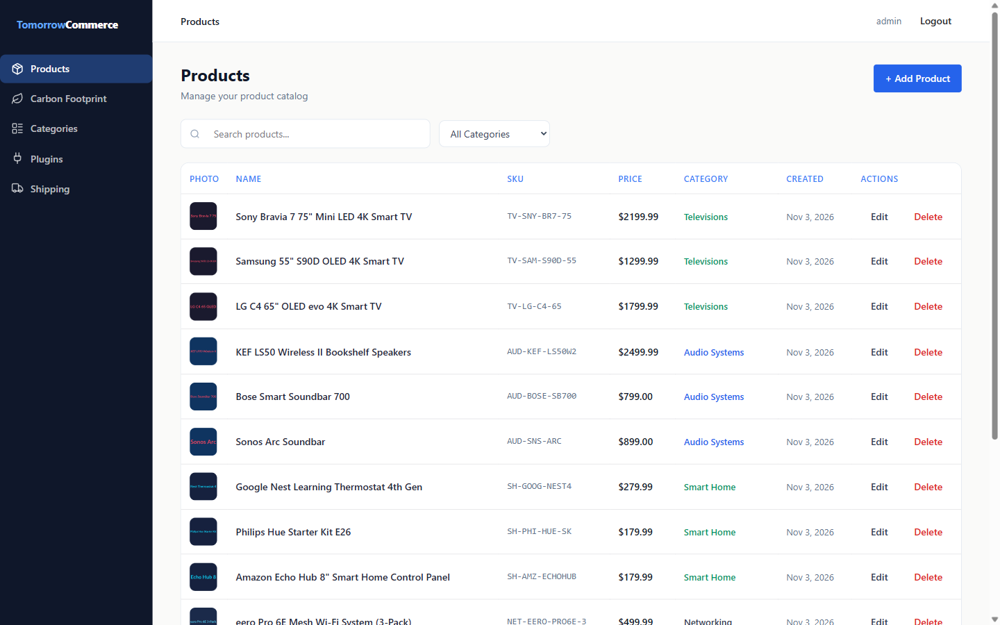

The page has two sections: **Carriers** at the top and **Delivery methods** below.

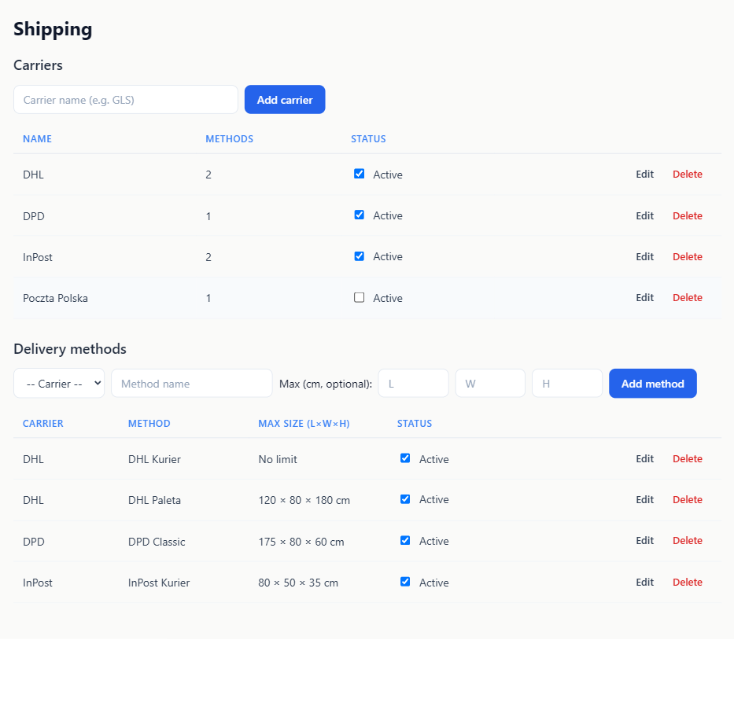

✅ **Tip for a new shop**: add your **carriers first**. A delivery method always belongs to a carrier.

---

## Managing carriers

The **Carriers** table shows each carrier's **Name**, the number of **Methods** it has, and its **Status**.

### How to add a carrier

1. **Type the name** in the box that says *Carrier name (e.g. GLS)*.
2. **Click "Add carrier".**

✅ **What you should see**: the carrier appears in the list as active. Carriers are listed alphabetically.

⚠️ If the name box is empty (or holds only spaces), you will see **"Carrier name is required."** and nothing is saved.

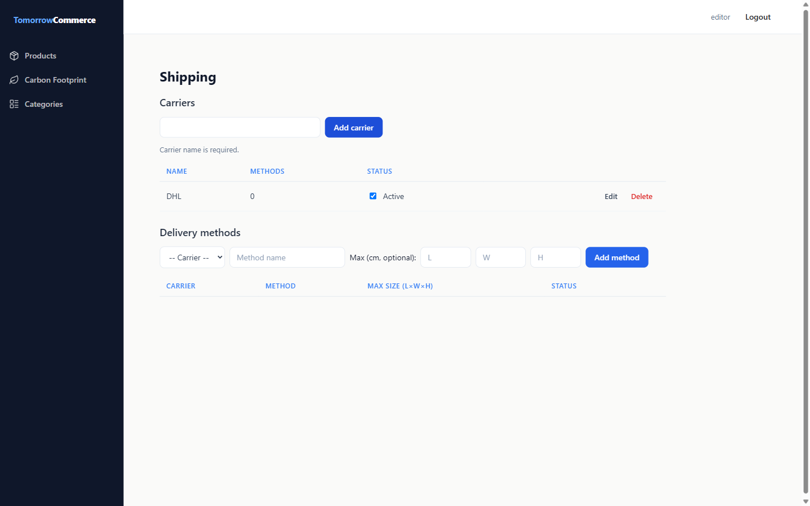

### How to rename a carrier

You can fix a typo or change a name without losing anything.

1. **Click "Edit"** on the carrier's row. The name turns into a text box.
2. **Change the name.** You can also tick or untick **Active** here.
3. **Click "Save"**, or **"Cancel"** to keep the old name.

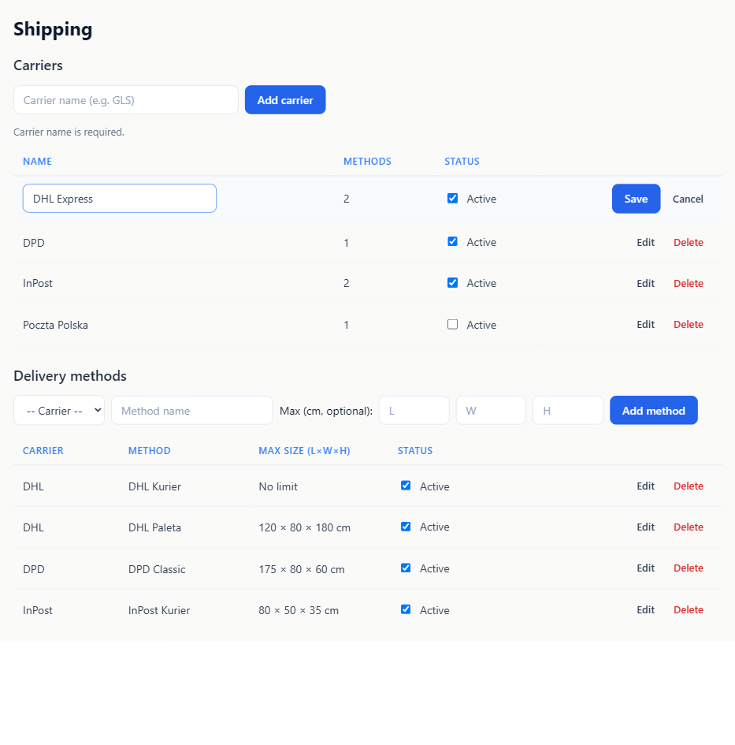

💡 **Good to know**:
- Only **one row can be edited at a time**, in either table. If you click **Edit** on another row, your unsaved changes in the first row are dropped without a warning.
- Renaming a carrier changes the name everywhere. Its methods and all product settings stay as they are.

### How to switch a carrier on or off

Tick or untick the **Active** checkbox in the **Status** column. The change is **saved straight away**.

Switching a carrier **off** pauses it without deleting anything:
- All its delivery methods count as *inactive* until you switch it back on.
- On the Delivery methods table, its methods show a **"Carrier inactive"** label.
- It no longer appears in the carrier list when you add a new method.

### How to delete a carrier

Click **"Delete"** on the carrier's row. There is **no "Are you sure?" question**, so the carrier is removed at once.

⚠️ **You can't delete a carrier that still has delivery methods.** Instead, you will see a message like this:

> Cannot delete "DPD": it still has 1 delivery method. Delete or move it first.
>
> Cannot delete "InPost": it still has 2 delivery methods. Delete or move them first.

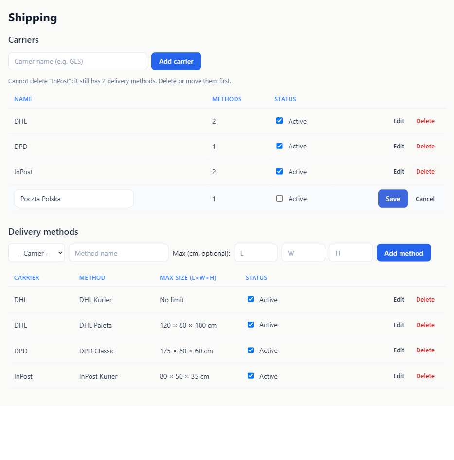

To fix it, either **delete those methods**, or **move them to another carrier** by editing each method and choosing a different carrier. Then delete the carrier again.

💡 **Tip**: If you only want to stop using a carrier for a while, **untick Active** instead of deleting it.

---

## Managing delivery methods

The **Delivery methods** table shows the **Carrier**, the **Method** name, the **Max size (L×W×H)** and the **Status**. The table is sorted by carrier, then by method name.

The size column can show:
- `80 × 50 × 35 cm`: the maximum length, width and height.
- `175 × 80 × — cm`: a dash means *no limit* for that side.
- `No limit`: the method takes parcels of any size.

### How to add a delivery method

1. **Pick the carrier** from the *-- Carrier --* list. Only **active** carriers are shown.
2. **Type the method name**, for example *InPost Paczkomat*.
3. **Optionally, enter the maximum size** in centimetres under **Max (cm, optional):**. Fill in **L** (length), **W** (width) and **H** (height).
4. **Click "Add method".**

💡 **About size limits**:
- **Leave a box empty** to mean *no limit* for that side. Leave all three empty if the method takes any size.
- The order of L, W and H **doesn't matter much**. When checking a product, the box may be **turned in any direction** to fit. For example, a 120 × 12 × 48 cm box still *fits* a method whose length limit alone is 130 cm.

⚠️ **Messages you might see**:

| Message | What it means | What to do |
|---|---|---|
| **Select a carrier.** | No carrier is chosen. | Pick a carrier from the list. |
| **Method name is required.** | The name box is empty. | Type a name. |
| **Limits must be positive numbers.** | A size is zero, negative, or something the browser can't read as a number (for example `1e999`). | Enter a number greater than 0, or leave the box empty. |

### How to edit a delivery method

1. **Click "Edit"** on the method's row.
2. **Change** the carrier, the name or the sizes, or tick or untick **Active**. To remove a limit, clear its box.
3. **Click "Save"**, or **"Cancel"** to keep things as they were.

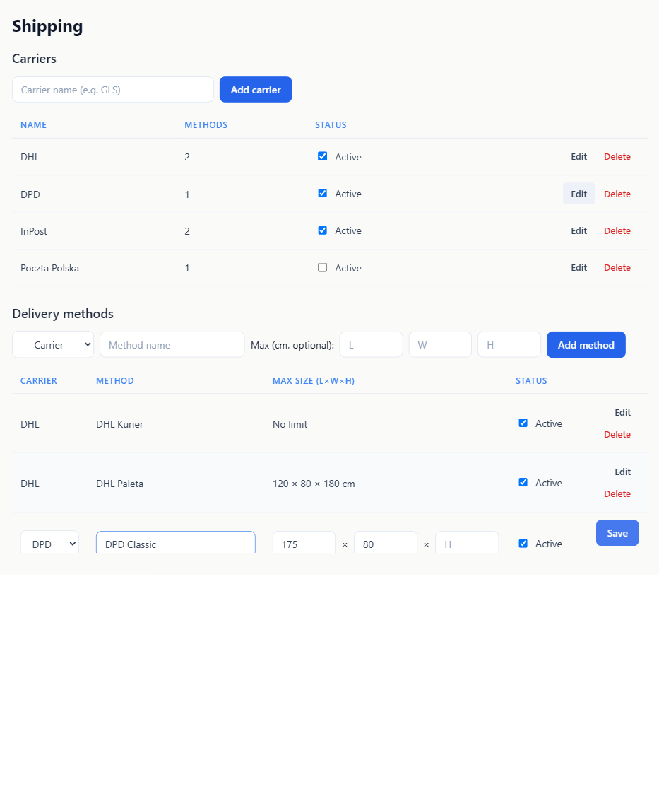

✅ **Your product settings are safe.** Editing a method keeps it the *same* method. If you switched it off for some products, it **stays switched off** for them after you rename it or change its sizes.

The same messages as in the add form apply, and only one row can be edited at a time.

### How to switch a method on or off

Tick or untick **Active** in the **Status** column. The change is saved straight away.

An inactive method is not offered for any product. Your per-product choices are **kept** and come back when you switch the method on again (see [below](#when-a-method-is-switched-off)).

If the method's **carrier** is switched off, the row also shows a **"Carrier inactive"** label.

### How to delete a delivery method

Click **"Delete"** on the method's row. It is removed at once, with no confirmation question.

### What viewers see

Viewers see the line **"You have read-only access. Ask an editor to change carriers or delivery methods."** There are no forms or buttons. The status column shows:
- **Active**: in use.
- **Inactive**: switched off.
- **Inactive (carrier)**: the method itself is on, but its carrier is switched off.

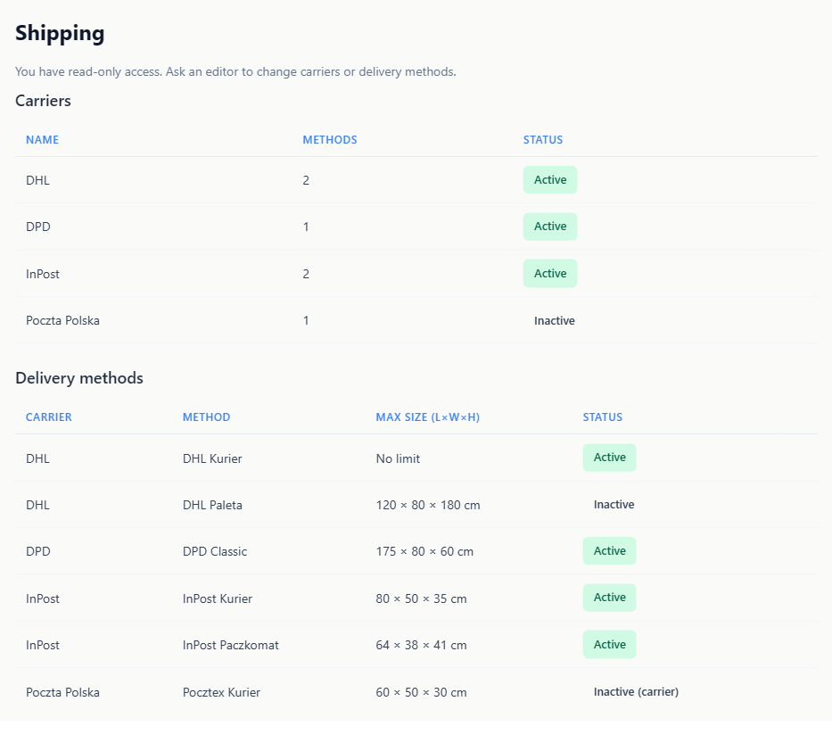

---

## Choosing delivery methods for a product

### How to open the product's Shipping tab

1. Go to **Products** and **open a product**.
2. **Click the "Shipping" tab** next to *Details* and *Box Size*.

You will see the heading **"Delivery methods for this product"**, a line about the box, and a table with every delivery method.

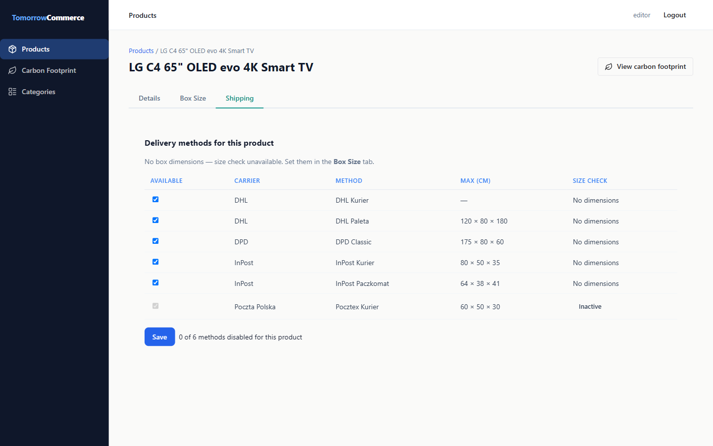

### Reading the box line

Just under the heading:
- **"Box: 120 × 12 × 48 cm (from Box Size)"**: the product's box size, taken from the **Box Size** tab.
- **"No box dimensions — size check unavailable. Set them in the Box Size tab."**: no box size has been entered yet. Open the **Box Size** tab, enter the **Length**, **Width** and **Height**, and save there.

### Reading the "Size check" badges

| Badge | Meaning |
|---|---|
| **Fits** (green) | The box fits within the method's size limits, in some direction. |
| **Too large** (red) | The box is bigger than the method allows. |
| **No limits** | The method has no size limits, so any box is fine. |
| **No dimensions** | The product has no box size yet, so the size can't be checked. |
| **Inactive** | The method or its carrier is switched off. Its checkbox is greyed out. |

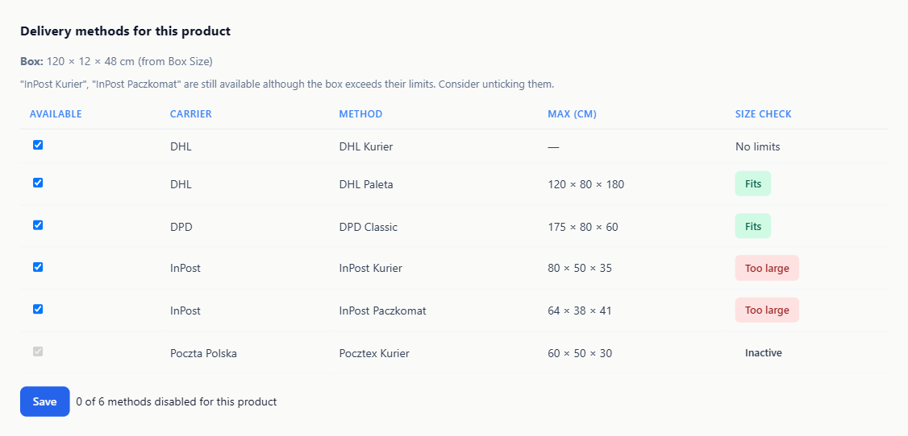

### How to switch off methods for this product

1. **Untick** the checkbox in the **Available** column for each method that should **not** be offered for this product.
2. **Click "Save".**

✅ **What you should see**: the button briefly says **"Saved!"**, then goes back to **"Save"**.

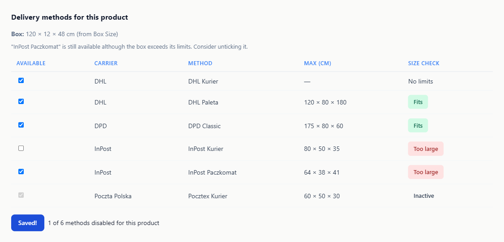

💡 **The counter** next to the button, for example **"1 of 6 methods disabled for this product"**, shows how many methods are switched off for this product, out of all methods. Switched-off inactive methods are counted too.

⚠️ Your ticks are **not saved until you click Save**. If you leave the page first, they are lost.

To make **every method available again**, tick all the boxes and click **Save**.

### The size warning is only advice

If a method is still ticked but the box is **Too large** for it, a warning appears above the table:

> "InPost Kurier", "InPost Paczkomat" are still available although the box exceeds their limits. Consider unticking them.

If only one method is affected:

> "InPost Paczkomat" is still available although the box exceeds its limits. Consider unticking it.

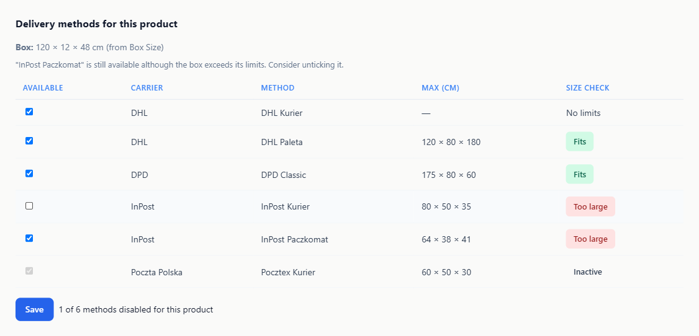

✅ **Nothing is switched off automatically.** The warning only suggests it, and you decide. For example, you may know the product ships in a smaller, folded package.

### When a method is switched off

If a delivery method (or its carrier) is switched off on the Shipping page:
- It shows **Inactive** on every product, and its checkbox can't be changed.
- Your choice for this product is **remembered**. In the picture below, *InPost Kurier 2* was unticked before it was switched off, so it stays unticked.
- When the method is switched **on** again, your earlier choice applies again automatically.

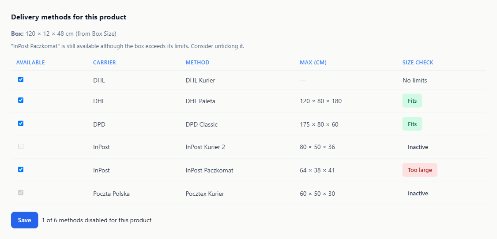

### What viewers see on the product tab

Viewers see **"Read-only: you can see which methods are available but not change them."** All checkboxes are greyed out, and there is no Save button or counter. The size warning is still shown.

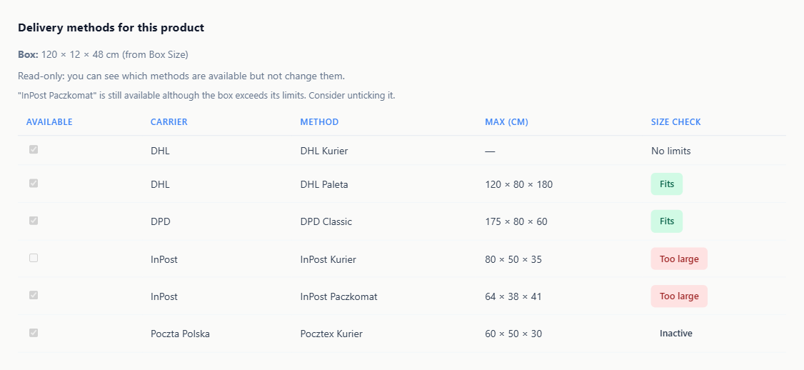

---

## Tips and best practices

💡 **Enter the box size first.** Without it, every method shows *No dimensions* and you get no size warnings.

💡 **Changed the Box Size? Click inside the Shipping tab.** The Shipping tab doesn't notice the change on its own when you switch back to it. **Click anywhere inside the Shipping tab once**, and the box line, badges and warning update. Your unsaved ticks are kept.

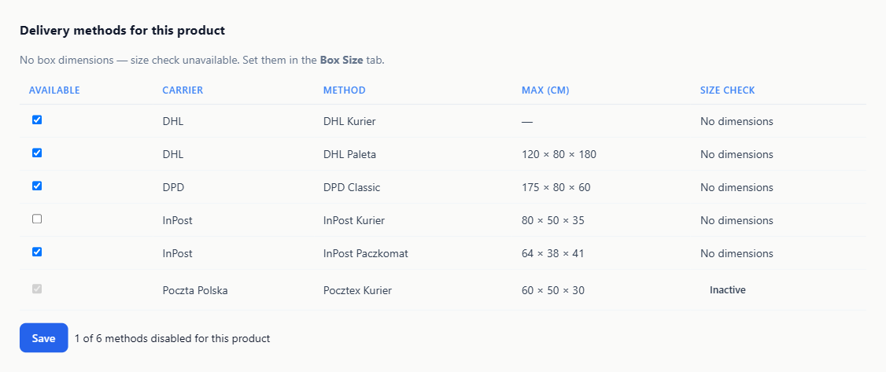

💡 **Pause, don't delete.** To stop using a carrier or method for a while, untick **Active**. Product settings are kept and come back when you switch it on again.

💡 **Rename freely.** Renaming a method or changing its limits never resets product settings.

💡 **Double-check sizes after saving.** Look at the **Max size** column to make sure the numbers you typed were saved.

---

## Questions and troubleshooting

**The product's Shipping tab says "No delivery methods configured. Add them in the Shipping section."**
No delivery methods exist yet. An editor needs to add them on the **Shipping** page in the sidebar. Viewers see the same message.

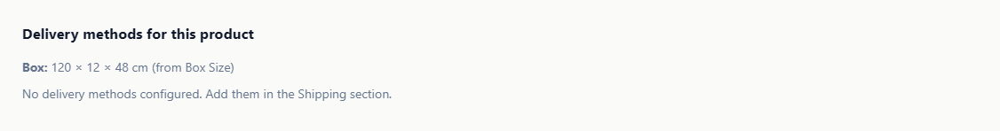

**I can't find Shipping in the sidebar.**
Reload the page (F5). If it is still missing, ask your administrator to check that the Shipping plugin is installed.

**My carrier isn't in the list when I add a method.**
Only active carriers are listed. Tick **Active** for that carrier first.

**I can't delete a carrier.**
It still has delivery methods. Delete them or move them to another carrier, then try again.

**I see "Too large", but the product should still ship that way.**
That's fine. Leave the method ticked. The warning is only advice.

**The box line still shows the old size.**
Click once inside the Shipping tab to refresh it.

**There are no checkboxes I can change and no Save button.**
You have read-only access. Ask an editor to make the change.

**An error message starts with "Failed to save" or "Failed to load shipping data".**
Something went wrong while talking to the server. Try again or reload the page. If you see a number like `403`, you don't have permission for that action.

---

## For administrators: registering the plugin

The plugin must be registered once before **Shipping** appears. An administrator uploads the plugin description (its manifest) with an admin token: `PUT /api/plugins/shipping/manifest`. The exact command is in `plugins/CLAUDE.md`, under *Shipping Plugin*. Size warnings also need the **Box Size** plugin to be registered.
