# AI Offer Analysis: User Guide

## TL;DR
- AI Offer Analysis checks each product for three things: how good the description is, whether it sits in the right category, and whether the price looks normal for that kind of product.
- You will find it on the product page in the **AI Offer Analysis** tab, in a small **AI review** badge on the **Details** tab, and as an **AI: needs review** switch on the product list.
- For editors it runs by itself the first time you open the tab, and again only after the product's name, description, price, SKU or category changes. Viewers see the last saved result.
- Red means "needs attention", green means "good", and grey means "uncertain or neutral". The price check is an AI estimate in US dollars, not live market data.

## Key Decisions
- **Results are suggestions, not rules.** The AI only flags things for a person to look at. Nothing in your product changes unless you edit it yourself.
- **It runs only when needed.** Opening the product page alone never starts an analysis. The analysis starts when an editor opens the tab, and only if the product is new to the analysis or has changed. This keeps it fast and avoids unnecessary AI usage.
- **All prices are treated as US dollars (USD).** The price check compares your price with what the AI knows about typical US retail prices for that type of product.

## Open Questions / Risks
- **AI answers can vary.** Running the analysis twice on the same product can give slightly different wording, and sometimes a different price verdict. Use the results as a second opinion.
- **Changes elsewhere are not detected.** If someone adds a new category or changes the prices of *other* products, the analysis does not update by itself. Click **Re-analyze** if you want a fresh opinion.

*Last updated: 12 November 2026*

---

## Contents
1. [What is AI Offer Analysis?](#what-is-ai-offer-analysis)
2. [Who can use it?](#who-can-use-it)
3. [Where to find it](#where-to-find-it)
4. [When the analysis runs](#when-the-analysis-runs)
5. [How to read the results](#how-to-read-the-results)
6. [Finding every product that needs review](#finding-every-product-that-needs-review)
7. [What viewers see](#what-viewers-see)
8. [If something goes wrong](#if-something-goes-wrong)
9. [Privacy: what happens to your product text](#privacy-what-happens-to-your-product-text)
10. [Tips and good habits](#tips-and-good-habits)

---

## What is AI Offer Analysis?

AI Offer Analysis is a quick quality check for your product listings. An AI assistant reads the product's name, description, price and category, and tells you:

- **Description quality**: Is the description specific and helpful, or is it vague, too short, or full of claims like "the best ever"?
- **Category fit**: Is the product in the right category? If not, which category would fit better?
- **Price vs market**: Is the price in line with what similar products usually cost in US shops, or is it much higher or lower?

If any of these looks wrong, the product is marked **Needs review**, so you can fix it before customers see it.

> **Note:** The price check is the AI's *estimate* of typical US retail prices. It does not look up live prices in other shops.

---

## Who can use it?

| You are... | What you can do |
|---|---|
| **Editor** (you can edit products) | See results, start a new analysis automatically by opening the tab, and use **Re-analyze** and **Retry** |
| **Viewer** (you can only look at products) | See the last saved result. You cannot start a new analysis. |

---

## Where to find it

AI Offer Analysis shows up in three places.

### 1. The "AI review" badge on the Details tab

Open any product. On the **Details** tab, below the product information, you will see a small one-line badge. It gives you the verdict at a glance, without opening the full analysis.

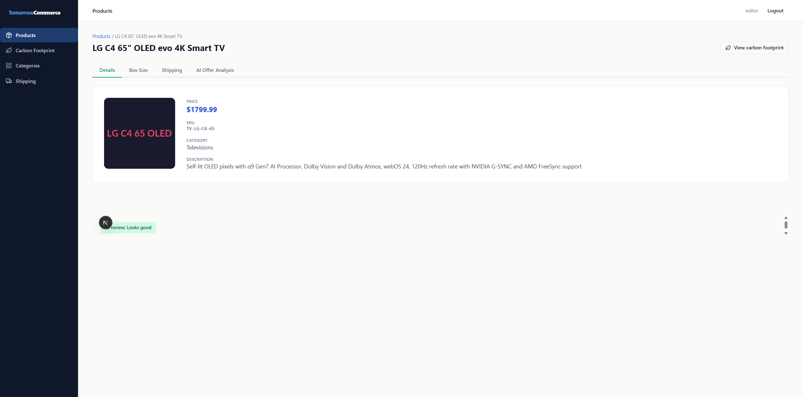

The badge can show:

| Badge | What it means |
|---|---|
| **AI review: Looks good** (green) | The last analysis found nothing that needs attention. |
| **AI review: Needs review** (red) plus a short reason | Something needs a closer look. The reason text tells you what, for example "category mismatch · poor description" or "price −90% below market". |
| **AI review: not analyzed yet** (grey) | No editor has opened the AI Offer Analysis tab for this product yet. |
| **AI review: unavailable** (grey) | The result could not be loaded right now. Try reloading the page. |

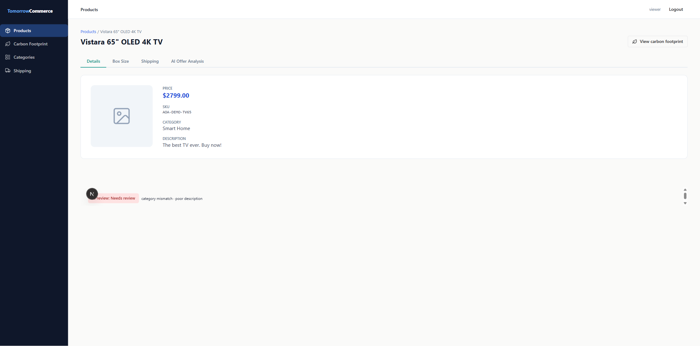

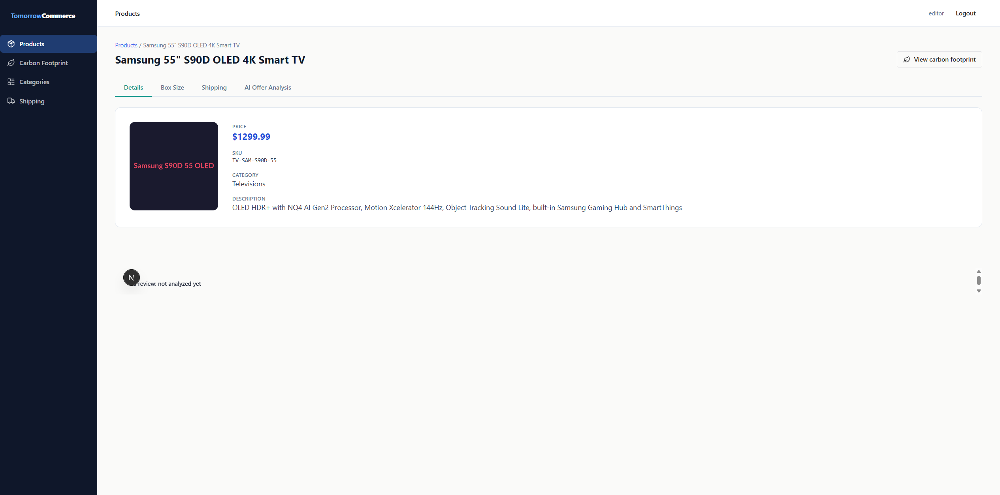

> **Note:** In these screenshots a small round "N" button covers the first letters of the badge. That button only appears in the developer test setup, so you will not see it in the normal app.

### 2. The "AI Offer Analysis" tab

Click the **AI Offer Analysis** tab at the top of the product page (next to Details, Box Size and Shipping). This shows the full analysis, with all three checks and the reasons behind them. See [How to read the results](#how-to-read-the-results).

### 3. The "AI: needs review" switch on the product list

On the **Products** page, next to the search box and the category filter, there is an **AI: needs review** switch. Turn it on to see only the products that need attention. See [Finding every product that needs review](#finding-every-product-that-needs-review).

---

## When the analysis runs

You don't need to press anything for the first analysis.

**For editors, the analysis starts by itself when:**
- you open the **AI Offer Analysis** tab, **and**
- the product has never been analyzed, **or** its name, description, price, SKU or category has changed since the last analysis.

**It does not run when:**
- you only open the product page and stay on the Details tab,
- the product hasn't changed since the last analysis (you will see the saved result right away),
- you switch between tabs on the same page,
- a viewer opens the tab.

### What you see while it runs

The analysis usually takes **5 to 15 seconds**. While it runs, you will see a progress bar and the message "Analyzing this offer…". A small line underneath explains why it started, for example "Started automatically: this product has not been analyzed yet." or "...product content changed since the last analysis."

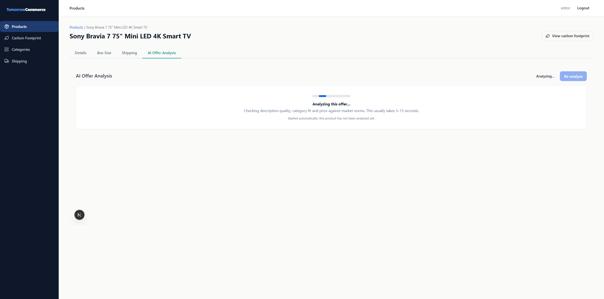

When it finishes, the result appears, and the AI review badge on the Details tab updates by itself. You don't need to reload the page.

### Running it again on demand (editors)

To get a fresh opinion, for example after you've improved the description, click **Re-analyze** in the top-right corner of the tab.

1. **Click "Re-analyze".**
   The button turns pale and can't be clicked while the analysis is running, so you can't start it twice by accident.

   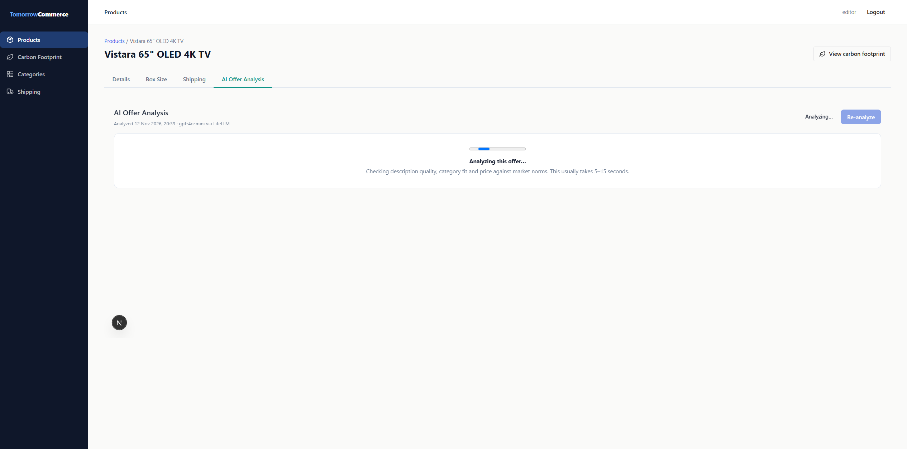

2. **Wait a few seconds.**
   The new result replaces the old one, and the "Analyzed ..." date under the title changes to the current time.

> **Tip:** You usually don't need Re-analyze after editing a product. The next time an editor opens the tab, the changed product is analyzed automatically.

---

## How to read the results

### The header

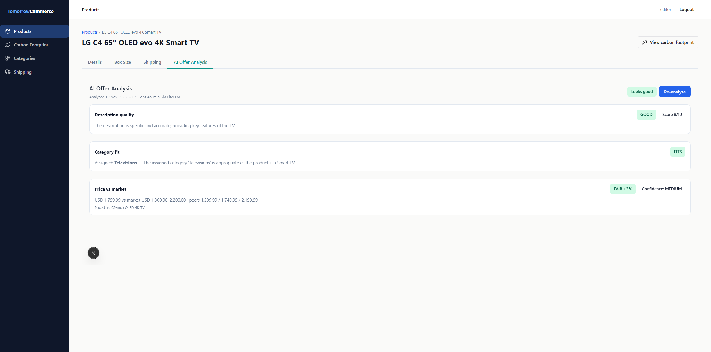

At the top of the tab you will see:
- **"Analyzed 12 Nov 2026, 20:39 · gpt-4o-mini via LiteLLM"**: when the analysis was made and which AI model was used, through the company AI gateway.
- **The overall verdict**: a green **Looks good** or a red **Needs review**.
- **Re-analyze** (editors only).

### Badge colours

Each check has its own coloured badge. The verdict is always written out in words, so you never have to rely on colour alone.

| Colour | Meaning | Examples |
|---|---|---|
| **Red** | Needs attention | POOR, MISMATCH, ABOVE MARKET +46%, BELOW MARKET −90% |
| **Green** | Good | GOOD, FITS, FAIR |
| **Grey** (plain) | Uncertain or neutral: worth a glance, but not a problem on its own | ACCEPTABLE, QUESTIONABLE, INSUFFICIENT DATA, a small price difference |

You may also see two grey helper badges:
- **Score 3/10**: the description score from 1 (worst) to 10 (best).
- **Confidence: LOW / MEDIUM / HIGH**: how sure the AI is about its price estimate. LOW is common for brands the AI doesn't know well.

### When is a product marked "Needs review"?

A product gets **Needs review** if **any** of these is true:
- the description is **POOR**,
- the category is a **MISMATCH**,
- the price is **ABOVE MARKET** or **BELOW MARKET** by **30% or more**.

Grey (uncertain) verdicts never mark a product as Needs review on their own.

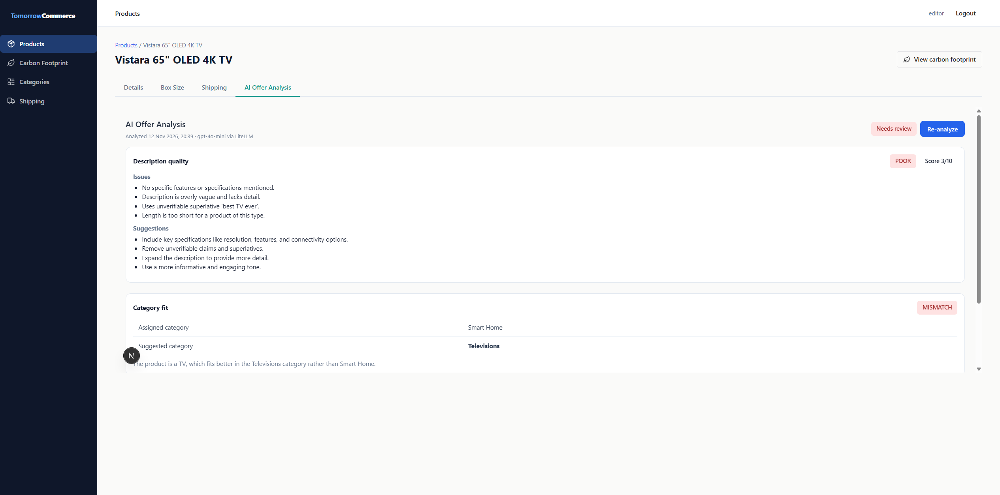

In the example above, the TV's description is just "The best TV ever. Buy now!", so it scores 3/10 with a list of **Issues** and **Suggestions**. It is also filed under "Smart Home", and the AI suggests **Televisions** instead.

The next example shows a grey **ACCEPTABLE** description: usable, but missing a few useful details. The product still **Looks good** overall.

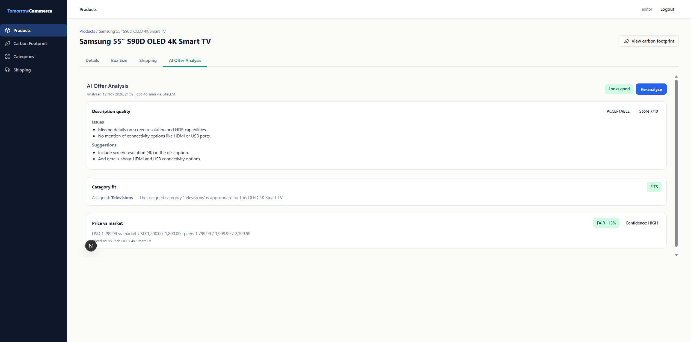

### Description quality

- **GOOD**: you see a one-sentence summary.
- **ACCEPTABLE or POOR**: you see a list of **Issues** (what's wrong) and **Suggestions** (how to improve it). Use the suggestions as a checklist when you edit the description.

### Category fit

- **FITS**: one line, for example "Assigned: **Televisions** — The assigned category is appropriate...".
- **QUESTIONABLE or MISMATCH**: a small table showing the **Assigned category** and, when there is a better option, the **Suggested category**, followed by a short explanation.

### Price vs market

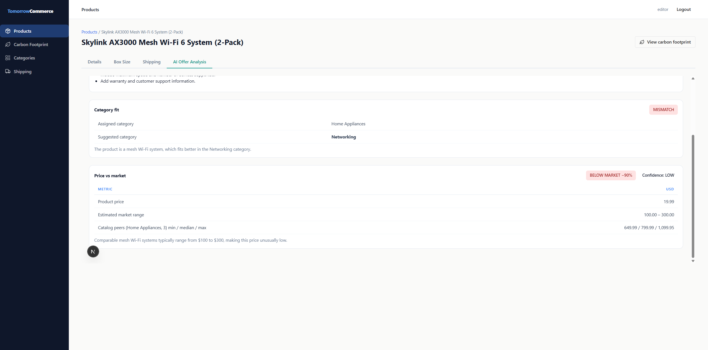

When the price is **FAIR**, you see one short line:
> USD 1,799.99 vs market USD 1,300.00–2,200.00 · peers 1,299.99 / 1,749.99 / 2,199.99

Otherwise you see a small table:

| Row | What it means |
|---|---|
| **Product price** | Your price, in USD. |
| **Estimated market range** | The AI's estimate of the usual US retail price for this type of product. |
| **Catalog peers (category, count) min / median / max** | The lowest, middle and highest price of the *other* products in the same category in your catalog, for comparison. |

Below the table, a short sentence explains the AI's reasoning.

The price badge shows how far your price is from the middle of the estimated range, for example **ABOVE MARKET +46%** or **FAIR −2%**.

**Two extra lines you may see:**

- **"Priced as: 65-inch OLED 4K TV"**: the type of product the AI thought it was pricing. If this looks wrong (for example, it thinks your TV is a speaker), the price verdict is probably wrong too. Improve the name or description and click **Re-analyze**.
- **"Market estimate unreliable — it matched catalog peers from a different category."**: this appears when the product is in the wrong category and the AI's price range looks like it was copied from the unrelated products in that category. In this case the market range shows as **"unreliable"** (or "market range unreliable"), the confidence is set to **LOW**, and the price does not count towards Needs review. **What to do:** move the product to the right category first, then run the analysis again.

> **Note:** Some older results don't have a "Priced as" line. That's normal; it appears after the next analysis.

---

## Finding every product that needs review

Use the list switch to build a quick to-do list of products to fix.

1. **Open the Products page** from the left menu.
2. **Turn on the "AI: needs review" switch** next to the category filter.
3. **Work through the list.** Only flagged products are shown. Click a product, open the **AI Offer Analysis** tab, and follow the suggestions.

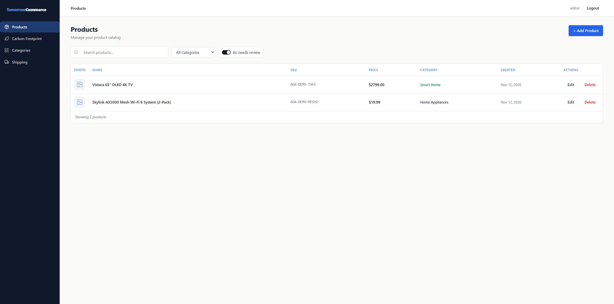

You can combine the switch with the search box and the category filter.

> **Note:** The list only knows about products that have been analyzed. Products that nobody has opened the AI tab for yet will not appear here, even if they have problems.

---

## What viewers see

If you can view products but not edit them:

- **If the product has been analyzed**, you see the full saved result, without the **Re-analyze** button.

  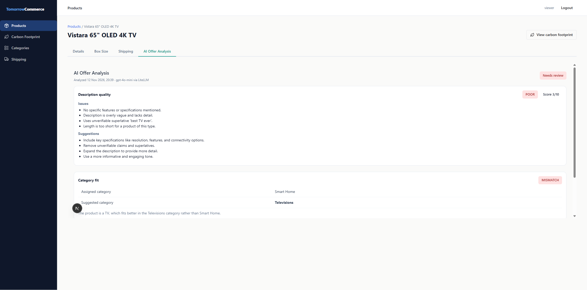

- **If the product changed after the analysis**, a note under the title says: "Product changed since this analysis. Only editors can run a new analysis." The result may be out of date, so ask an editor to open the tab.

- **If the product has never been analyzed**, you see "Not analyzed yet — An editor needs to open this tab to run the first analysis."

  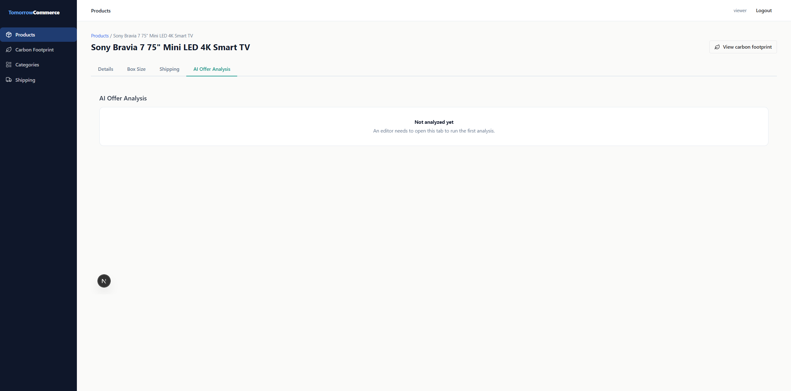

---

## If something goes wrong

If the analysis can't finish, you'll see a message in the tab and a **Retry** button (editors only). **No partial result is saved**, so your previous result (if any) stays as it was.

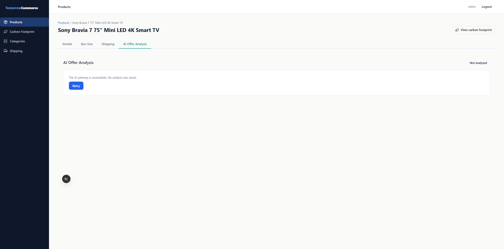

> **Important:** If an automatic analysis fails, it is **not** repeated by itself, even if you switch tabs. Click **Retry** when you're ready.

| Message | What it means | What to do |
|---|---|---|
| "The AI gateway is unavailable. No analysis was saved." | The AI service is down or busy. | Wait a minute and click **Retry**. |
| "The AI gateway did not respond in time. No analysis was saved." | The AI took too long. | Click **Retry**. |
| "The AI returned an unreadable result. No analysis was saved." | The AI's answer was garbled. | Click **Retry**. It usually works the second time. |
| "The AI gateway rejected the request (content policy). No analysis was saved." | The product text contains data that isn't allowed to be sent, such as a **card number**. | Edit the product, remove that data, then click **Retry**. |
| "The host application could not provide or store the analysis data." | The app couldn't load or save the result. | Try again later. If it keeps happening, contact your administrator. |
| "Your session has expired. Please log in again." | You've been logged out. | Log in again and reopen the tab. |
| "Only editors can run an analysis." | Your account can't start an analysis. | Ask an editor. |
| "Network error. Please check your connection and try again." | Your internet connection dropped. | Check your connection and click **Retry**. |
| "Could not load the analysis." | The saved result couldn't be loaded. | Reload the page. |

For the content-policy message, the tab also shows a hint: "The product text may contain data blocked by the gateway (e.g. a card number). Edit the product and try again."

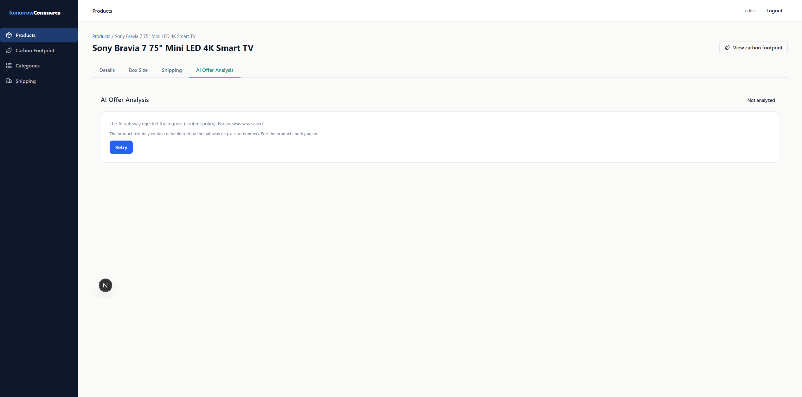

---

## Privacy: what happens to your product text

- The product's name, description, price and category, plus the names and prices of other products in the same category, are sent to the AI. The SKU is not sent.
- Everything goes through the **company AI gateway**, never directly to an outside AI provider.
- The gateway **masks personal data** such as email addresses and phone numbers before the AI sees it.
- The gateway **blocks** text that contains **card numbers**. You will see the "content policy" message described above.
- Even so, product descriptions should never contain personal or payment data. If you find any, remove it.

---

## Tips and good habits

- **Fix the category first.** A wrong category can confuse the price check. Once the category is right, the price verdict is more reliable.
- **Write specific descriptions.** Mention the key specs for the product type (size, resolution, connectivity and so on). Avoid unverifiable claims like "the best ever".
- **Read the reasoning, not just the badge.** A grey verdict or a LOW confidence is a hint, not a problem.
- **Use the list switch weekly.** Turn on **AI: needs review** to see what still needs fixing.
- **Remember it's an estimate.** You know your products and prices best. If the AI is clearly wrong, you can ignore it.

---

## Related features

- **Product Details tab**: where you edit name, description, price, SKU and category.
- **Categories page**: where you manage the category list the AI chooses suggestions from.
