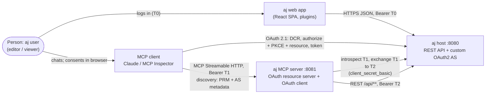
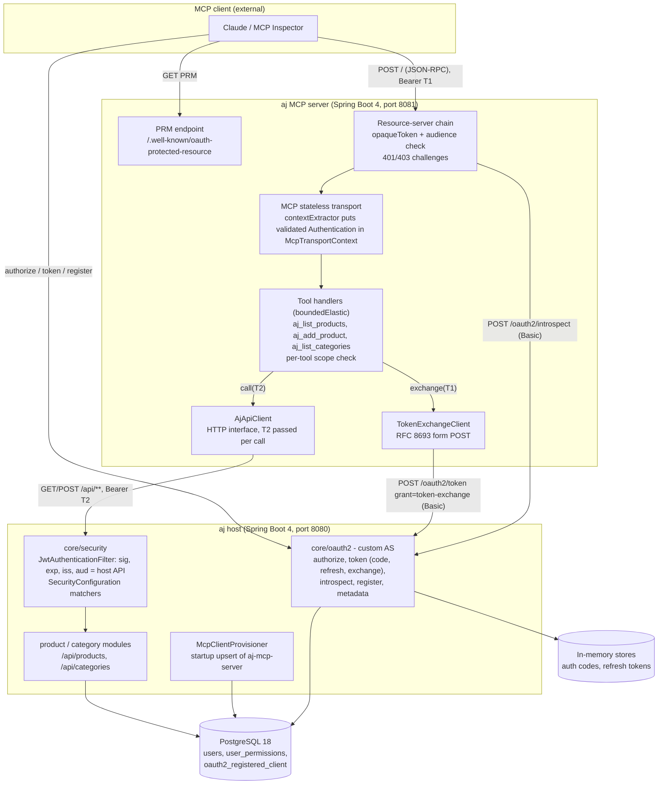
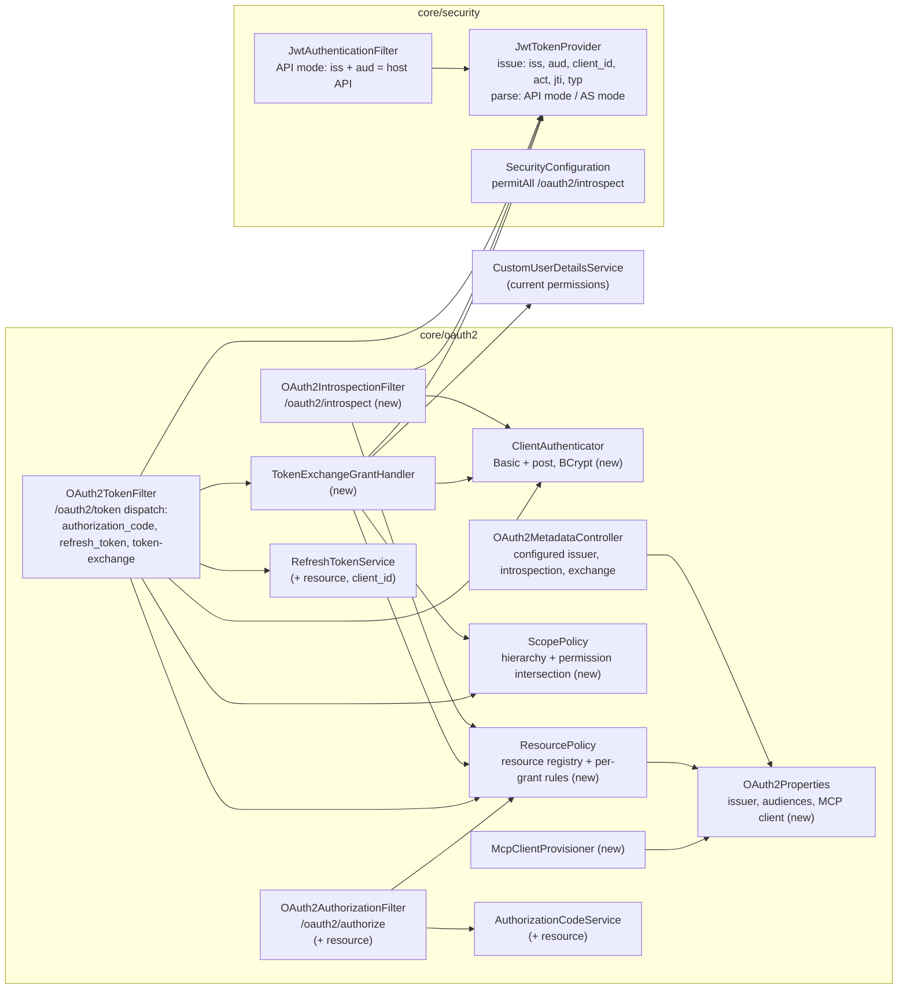
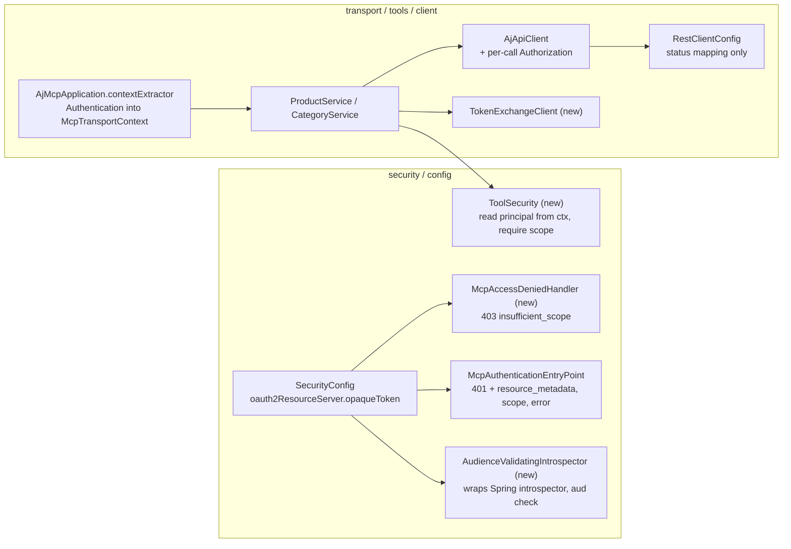
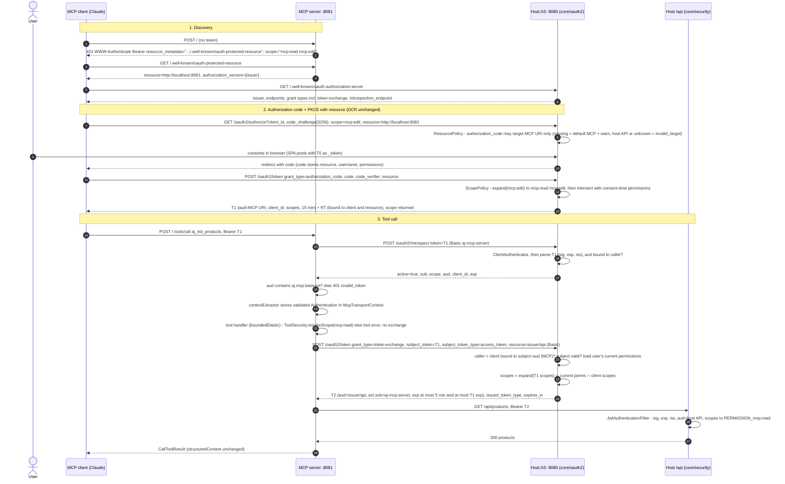

# High-Level Design: MCP auth without token passthrough (validate, then exchange)

## TL;DR
- The MCP server becomes a real **OAuth resource server and OAuth client**. It accepts only tokens whose `aud` is its own URL (checked via **RFC 7662 introspection** at the host, no cache). For every tool call it **exchanges** the user's token (**RFC 8693**) for a ≤ 5 min token with `aud` = host API, `act` = MCP server and scopes ∩ the user's current permissions. The client's token never reaches `/api`.
- The host gets **one configured issuer, an `aud` on every token, and an `aud` + `iss` gate on `/api`**. A per-grant resource policy means only the token-exchange grant, called by the MCP confidential client, can mint a host-API token.
- Package **P1 "course-aligned secure minimum"** (1A, 2B, 3A, 4A, 5A, 6A, 7A, 8B). Tool names, inputs and outputs stay the same (course L07 success criterion). No schema migration. Both apps ship together in one change.

## Key Decisions
- Validate-then-exchange replaces passthrough. This is the RFC 8693 §1 case and what the course (L07), the team standard and every vendor pattern found use ([ADR-001](decision-log.md#adr-001)).
- URI audiences: MCP = `aj.mcp.base-url`, host API = `${issuer}/api`. A missing `resource` defaults to the MCP URI with a warning. An unknown one gets `invalid_target` ([ADR-002](decision-log.md#adr-002)).
- `/api` requires `iss` + `aud` = host API. Only the exchange grant, called by the client bound to the MCP resource, may mint that audience ([ADR-003](decision-log.md#adr-003)).
- `mcp:edit` ⊃ `mcp:read`, normalised at issuance and kept in T2. Scopes ∩ user permissions at both the auth-code and exchange grants ([ADR-004](decision-log.md#adr-004)).
- A hand-written `TokenExchangeClient`. The validated `Authentication` travels in `McpTransportContext` and T2 is passed explicitly to `AjApiClient`. The `AccessTokenHolder` ThreadLocal is deleted ([ADR-005](decision-log.md#adr-005)).
- Introspection (`/oauth2/introspect`, caller auth required) with no cache, an exchange per tool call with no cache, and HS256 kept ([ADR-006](decision-log.md#adr-006)).
- Implicit delegation: the AS adds `act: {sub: <mcp client_id>}` ([ADR-007](decision-log.md#adr-007)).
- One `ClientAuthenticator` (Basic + post, BCrypt). The `aj-mcp-server` confidential client is upserted at startup from env ([ADR-008](decision-log.md#adr-008)).
- Same-touch hygiene is bundled in: no token logging (FU-3), local default URLs and env wiring (FU-5), refresh tokens bound to their client (FU-2a) ([ADR-009](decision-log.md#adr-009)).

## Open Questions / Risks
- **What `resource` value Claude sends is unverified.** Exact string match is used, with no URI normalisation (a stretch item). A trailing slash would cause `invalid_target`. The test plan covers the omitted and exact cases. A manual check with a real client is part of rollout.
- **The `contextExtractor` must run on the servlet thread after the security filter chain** (ADR-005, assumption I5: High confidence from bytecode, but untested end to end). The first implementation task should be a spike test proving this. Fallback: `immediateExecution(true)`.
- **MCP-13 (403 `insufficient_scope`, SHOULD) is only partly met.** HTTP 403 is returned when a valid token carries no `mcp:*` scope at all. A per-tool shortfall (an `mcp:read` token calling `aj_add_product`) is reported as a tool error, because all tools share one JSON-RPC endpoint. Inspecting the JSON-RPC body to emit HTTP 403 is deferred.
- **The issued `scope` can be wider than requested** (`mcp:edit` → `mcp:read mcp:edit`). OAuth 2.1 allows this, but Claude's handling of it has not been checked.
- **Two extra local HTTP calls per tool call** (introspect + exchange). Unmeasured, reasoned to be cheap.
- **Existing sessions are invalidated at rollout.** T0s and T1s issued before the change have no `aud`, so users log in again and Claude re-authorises. This is expected and documented in Migration.
- **The committed `APP_JWT_SECRET` default stays in place** as a fallback for tests and ad-hoc runs. `start-dev` overrides it. Removing the default is outside P1.

---

## Design Overview

**Business context.** aj's MCP server lets AI agents (Claude) list and create products and categories on behalf of a logged-in user. Today it is a **trust-and-forward relay**: it accepts any `Bearer` string and re-sends the client's token to the host, and the host accepts any token signed with its one HMAC key. MCP 2026-07-28 forbids exactly this (MCP-07/-11/-29/-31). The repo is also the course's M04 exercise baseline (`bd4de70`), and L07 expects the fixed shape. The beneficiaries are end users (whose authority can no longer be replayed or escalated), course students (who get a reference solution) and developers (whose local stack works out of the box).

**Chosen approach.** **Validate-then-exchange (delegation)** on the existing hand-written host AS. The MCP server validates inbound tokens through **RFC 7662 introspection** with an explicit **audience check** against its RFC 9728 `resource`. It authenticates as its own **confidential client** and calls **RFC 8693 token exchange** per tool call to obtain a short-lived **host-API-audience token (T2)** carrying `act`. The host binds every token to an **audience** (RFC 8707 `resource` → `aud`), enforces `aud` + `iss` on `/api`, and restricts the host-API audience to the exchange grant. The architectural style is unchanged: a **modular-monolith host with an embedded custom AS, plus a separate stateless MCP resource server**. The change is confined to the security planes of both apps.

**Key decisions:**
- Every token is minted for exactly one audience, and every resource server rejects tokens minted for someone else. This closes replay in both directions.
- The MCP server never holds a signing key and never forwards inbound tokens. It only returns them to their issuer (introspection, exchange).
- Authorisation stays per user. T2 scopes are the subject scopes ∩ the user's **current** permissions, so the deputy can never exceed the user.
- No caches, no framework defaults to override, no key migration, no schema migration. That keeps the change explicit and reversible.

---

## Architecture

### System Context (C4 Level 1)

**What changes at this level:** the MCP to host relationship splits into two. There is an **OAuth relationship** (introspect, exchange: the MCP server is a confidential client) and a **resource relationship** (`/api` with T2 only). Before the change it was a single "forward T1" edge. Users, the SPA and the plugins keep T0, which now carries `aud` = host API.

### Container Overview (C4 Level 2)

| Container | Responsibility (after the change) |
|---|---|
| **MCP server: resource-server chain** | Rejects every request whose bearer token is not active, not for `aj.mcp.base-url`, or carries no `mcp:*` scope. Emits RFC 6750/9728 challenges |
| **MCP server: transport + tools** | Carries the validated principal to tool handlers explicitly. Each tool checks its scope, exchanges, and calls the host with T2 only |
| **MCP server: TokenExchangeClient** | The one place that talks RFC 8693. It authenticates as `aj-mcp-server` and validates `issued_token_type` |
| **Host: custom AS (`core/oauth2`)** | Issues T1, T2 and refresh tokens with `aud`/`iss`/`client_id`/`jti`/`typ`. Introspects. Enforces the resource policy, the scope policy and client authentication |
| **Host: API security (`core/security`)** | Accepts only tokens with the configured `iss` and `aud` = host API (T0, T2). Authorisation matchers are unchanged |
| **Host: McpClientProvisioner** | Creates or updates the `aj-mcp-server` confidential client from env at startup |
| **PostgreSQL** | Unchanged schema. The MCP client is a row in the existing `oauth2_registered_client` table |
| **In-memory stores** | Authorisation codes gain `resource`. Refresh tokens gain `resource` + `client_id` |

### Component views of the security planes (requested zoom-in, logical only)

These two views name the logical pieces inside the two security planes, so the change map below has an anchor. They stop at component level. Classes and fields belong in the specification.

**Host authorization server + API gate**

**MCP server security plane**

---

## Token Inventory

| | **T0** app session | **T1** MCP access token | **T2** exchanged backend token | **RT** refresh token | **MCP client secret** |
|---|---|---|---|---|---|
| Issued by | host `POST /api/auth/login` | host `POST /oauth2/token` (`authorization_code` + PKCE, `refresh_token`) | host `POST /oauth2/token` (`urn:ietf:params:oauth:grant-type:token-exchange`) | host, alongside T1 | env `AJ_OAUTH_CLIENT_SECRET`, BCrypt-hashed by `McpClientProvisioner` |
| Format | JWT HS256 | JWT HS256, header `typ: at+jwt` | JWT HS256, header `typ: at+jwt` | opaque random, in memory | shared secret |
| `iss` | configured `app.oauth2.issuer` (**new**) | configured issuer (was request-derived) | configured issuer | n/a | n/a |
| `aud` | host API `${issuer}/api` (**new**) | MCP URI `aj.mcp.base-url` (**new**, from `resource` or default) | host API `${issuer}/api` | stored `resource` = MCP URI (**new**) | n/a |
| `sub` | username | username | username (from T1) | username | n/a |
| `client_id` | — | MCP client's DCR id (**new**) | `aj-mcp-server` | stored, checked on refresh (**new**, FU-2a) | `aj-mcp-server` |
| `act` | — | — | `{sub: "aj-mcp-server"}` (**new**) | — | — |
| Rights claim | `permissions` [READ, EDIT, ...] | `scopes` = expand(requested) ∩ perm-scopes(consent-time permissions), e.g. [`mcp:read`, `mcp:edit`] | `scopes` = expand(T1 scopes) ∩ perm-scopes(**current** permissions) ∩ client scopes | stored issued scope | allowed scopes `mcp:read mcp:edit` |
| `jti` | — | UUID (**new**) | UUID (**new**) | — | — |
| Lifetime | 24 h (unchanged) | 15 min (unchanged) | min(now + 5 min, T1 `exp`) | 24 h, rotated (unchanged) | until rotated in env |
| Validated by | host `JwtAuthenticationFilter` (API mode) | MCP server via host `/oauth2/introspect` + local `aud` check. Host AS (AS mode) during exchange | host `JwtAuthenticationFilter` (API mode) | host `RefreshTokenService` | host `ClientAuthenticator` |
| May be presented to | host `/api/**`, `/oauth2/authorize` (consent via `_token`) | MCP server only, plus back to its issuer (introspect, exchange) | host `/api/**` only | host `/oauth2/token` only, by the same client | host `/oauth2/introspect`, `/oauth2/token` |
| Rejected at | MCP server (introspection: `active:false`, `aud` not MCP) | host `/api` (`aud` not host API) | MCP server (`active:false`). Exchange (subject `aud` not MCP) | any other client | — |

Permission-scope mapping (one function, `ScopePolicy`): `READ` ↔ `mcp:read`, `EDIT` ↔ `mcp:edit`. Unknown scopes are dropped. The hierarchy is expanded **before** intersection, so a user's permissions always bound the result: an EDIT-only user requesting `mcp:edit` gets `mcp:edit` only. If the result is empty, the grant fails with `invalid_scope`.

---

## End-to-End Sequence

---

## Key Components

| Component | Purpose | Responsibilities | Key Interfaces | Dependencies |
|---|---|---|---|---|
| **ResourcePolicy** (host, new) | Single source of truth for which audiences exist and which grant may target them | Resolve `resource` → canonical audience. Apply defaults (missing → MCP + WARN). Reject unknown ones and disallowed grant/resource pairs (`invalid_target`). Know which confidential client is bound to which resource | `resolveForGrant(grant, resourceParam)`, `boundResourceOf(clientId)` | `OAuth2Properties` |
| **ScopePolicy** (host, new) | One function for scope hierarchy and least privilege | Expand `mcp:edit` → `+mcp:read`. Intersect with permission scopes and client scopes. Drop unknown scopes | `issue(requested, permissions, clientScopes)` | — |
| **ClientAuthenticator** (host, new) | Reusable confidential-client authentication | Parse `client_secret_basic` and `client_secret_post`, reject both being sent at once, BCrypt-verify. Return the authenticated `RegisteredClient` or `invalid_client` | `authenticate(request)` | `RegisteredClientRepository`, `PasswordEncoder` |
| **TokenExchangeGrantHandler** (host, new) | RFC 8693 grant | Validate the subject (sig, exp, iss, access token, `aud` = caller's bound resource). Load current permissions. Compute scopes. Mint T2 with `act`. Respond with `issued_token_type`, `expires_in`, no RT | invoked by the `OAuth2TokenFilter` dispatch | ClientAuthenticator, ResourcePolicy, ScopePolicy, CustomUserDetailsService, JwtTokenProvider |
| **OAuth2IntrospectionFilter** (host, new) | RFC 7662 endpoint | Require an authenticated confidential caller. Return active metadata only for valid access tokens whose `aud` is the caller's bound resource, otherwise `{active:false}` with no detail | `POST /oauth2/introspect` | ClientAuthenticator, ResourcePolicy, JwtTokenProvider |
| **JwtTokenProvider** (host, changed) | Token minting and parsing | Add `iss`/`aud` to T0. Add `aud`/`client_id`/`jti`/`typ`/optional `act` to OAuth tokens. Two parse modes: **API** (requires issuer + `aud` = host API) and **AS** (requires issuer, returns `aud`/`client_id`/`act`/`exp` for policy checks) | `generateToken`, `generateOAuth2Token(...)`, `parseApiToken`, `parseAccessToken` | `OAuth2Properties` |
| **McpClientProvisioner** (host, new) | Provision the MCP confidential client without committed secrets | On startup, idempotently upsert `aj-mcp-server` (grant token-exchange, auth methods Basic + post, scopes `mcp:read mcp:edit`, BCrypt secret). Skip with a WARN when the secret env var is absent | `ApplicationRunner` | `RegisteredClientRepository`, `OAuth2Properties` |
| **AudienceValidatingIntrospector** (MCP, new) | Inbound validation | Delegate to Spring's introspector (Basic auth). Require `aud` ∋ `aj.mcp.base-url`. Map `scope` → `SCOPE_mcp:*` | `OpaqueTokenIntrospector` | host `/oauth2/introspect` |
| **ToolSecurity** (MCP, new) | Per-tool authorisation from the transport context | Read the validated `Authentication` from `McpTransportContext`. Require a scope. Expose the subject token for exchange | `requireScope(ctx, scope)` | `McpTransportContext` |
| **TokenExchangeClient** (MCP, new) | Outbound credential | One form POST to `/oauth2/token`. Validate `issued_token_type` and `token_type`. Map AS errors to `McpToolException` without echoing tokens | `exchange(subjectToken) → BackendToken` | `RestClient`, MCP client credentials |

---

## Component Change Map

The orchestrator asked for paths, so this section gives them as orientation for the specification. Class names marked *(new)* are proposals the spec may rename.

### Host (`src/main/java/pl/devstyle/aj/...`)
| Path | Change | Gaps closed |
|---|---|---|
| `core/oauth2/OAuth2Properties.java` *(new)* | `@ConfigurationProperties("app.oauth2")`: issuer, api audience, MCP resource, MCP client id/secret, exchange TTL | H1, FU-5 |
| `core/oauth2/ResourcePolicy.java` *(new)* | Resource registry + per-grant rules + client→resource binding (config-backed, no DB column) | H2, DA-2 |
| `core/oauth2/ScopePolicy.java` *(new)* | Hierarchy + intersection | H7, F6 |
| `core/oauth2/ClientAuthenticator.java` *(new)* | Basic + post, BCrypt | H3 |
| `core/oauth2/TokenExchangeGrantHandler.java` *(new)* | RFC 8693 grant | H6 |
| `core/oauth2/OAuth2IntrospectionFilter.java` *(new)* | RFC 7662 endpoint | H5 |
| `core/oauth2/McpClientProvisioner.java` *(new)* | Startup upsert of `aj-mcp-server` | H4 |
| `core/oauth2/OAuth2TokenFilter.java` | Dispatch the `token-exchange` branch. Read `resource`. Use `ClientAuthenticator` for confidential clients. Apply `ScopePolicy` at auth-code issuance. Use the configured issuer. Check client binding on refresh. **Remove token, code, verifier, secret and parameter-map logging** | H1, H2, H3, H6, H7, H9, FU-3, FU-2a |
| `core/oauth2/OAuth2AuthorizationFilter.java` | Read and validate `resource` (ResourcePolicy), store it with the code. Remove parameter-map logging | H2, FU-3 |
| `core/oauth2/AuthorizationCodeService.java` | `AuthorizationCodeData` + `resource` | H2 |
| `core/oauth2/RefreshTokenService.java` | `RefreshTokenData` + `clientId`, `resource`. Reject rotation requested by a different client | H2, FU-2a |
| `core/oauth2/OAuth2MetadataController.java` | Configured issuer. `introspection_endpoint`, `introspection_endpoint_auth_methods_supported`. Token exchange in `grant_types_supported` | H1, H8 |
| `core/oauth2/OAuth2Error.java` | Add `INVALID_TARGET` | H2 |
| `core/security/JwtTokenProvider.java` | Claims (`iss`/`aud` on T0. `aud`, `client_id`, `jti`, `typ`, `act` on OAuth tokens). API and AS parse modes | S1, S2, S3 |
| `core/security/JwtAuthenticationFilter.java` | Use the API parse mode (rejects T1, foreign `iss`, missing `aud`). `_token` handling unchanged (FU-4 deferred) | S3 |
| `core/security/SecurityConfiguration.java` | `permitAll` `POST /oauth2/introspect` (client auth inside, like `/oauth2/token`). Register the introspection filter. Matchers unchanged | S4 |
| `src/main/resources/application.properties` | `app.oauth2.*` keys with local defaults. CORS origins env-overridable with a local default | FU-5 |
| `start-dev.sh`, `start-dev.ps1` | Export `AJ_OAUTH_CLIENT_ID`, `AJ_OAUTH_CLIENT_SECRET`, `APP_JWT_SECRET` (generated per run unless already set) and the URL variables for **both** apps | FU-5, DA-7 |
| `PublicClientRegistrationFilter.java` | **Unchanged.** It already rejects grant types other than auth-code/refresh, so DCR cannot register a token-exchange client | — |

### MCP server (`mcp-server/src/main/java/pl/devstyle/aj/mcp/...`)
| Path | Change | Gaps closed |
|---|---|---|
| `security/McpJwtFilter.java` | **Delete** | M2, F1 |
| `security/AccessTokenHolder.java` | **Delete** | M5, V7 |
| `security/AudienceValidatingIntrospector.java` *(new)* | Wraps Spring introspector, `aud` check, scope mapping | M2 |
| `security/McpAccessDeniedHandler.java` *(new)* | 403 `insufficient_scope` challenge | M3 |
| `security/ToolSecurity.java` *(new)* | Principal from context + scope check | M6 |
| `security/McpAuthenticationEntryPoint.java` | Add `scope="mcp:read mcp:edit"`. Add `error="invalid_token"` only when a token was presented | M3 |
| `client/TokenExchangeClient.java` *(new)* | RFC 8693 client | M5 |
| `client/AjApiClient.java` | Each method takes the `Authorization` header value as an explicit parameter | M5 |
| `config/SecurityConfig.java` | `oauth2ResourceServer(opaqueToken)` with the introspector. Entry point and denied handler. Require an `mcp:*` scope on `/` | M2, M3 |
| `config/RestClientConfig.java` | Delete `JwtForwardingInterceptor`. Keep the status mapping: 401 → `apiError` (no retry), never log auth headers | M5, M7 |
| `AjMcpApplication.java` | Remove `TOKEN_KEY`. `contextExtractor` stores the validated `Authentication` from `SecurityContextHolder` | M4, V6 |
| `service/ProductService.java`, `service/CategoryService.java` | Remove `String token` parameters and the holder. `ToolSecurity.requireScope` → `TokenExchangeClient.exchange` → `AjApiClient.x(bearer T2, ...)`. Tool specs, schemas and results unchanged | M6 |
| `exception/McpToolException.java` | Add an `insufficientScope(required)` static factory | M6 |
| `controller/WellKnownController.java` | Unchanged logic. Values come from local defaults | M9 |
| `src/main/resources/application.yml` | Local defaults for `aj.oauth.server-url`, `aj.mcp.base-url`. Add `aj.oauth.client-id/secret`, `aj.oauth.introspection-uri`, `aj.oauth.token-uri`, `aj.backend.resource` | M8, FU-5 |
| `mcp-server/pom.xml` | Add the Boot 4 OAuth2 resource-server starter (confirm the artifact name against the 4.0.5 BOM) and `spring-security-test` | M1 |

### Documentation and standards (same change)
| File | Update |
|---|---|
| `.maister/docs/standards/mcp-server/conventions.md` | "No Token Passthrough" now matches the code. Introspection with `aud` = `aj.mcp.base-url`, no cache. Exchange per tool call, no cache. Validated principal via `McpTransportContext` (no ThreadLocal, no raw header). **T2 keeps `mcp:*` scopes** (`mcp:edit` ⊃ `mcp:read`, normalised at the AS, ∩ user permissions), replacing "map `mcp:read`→READ". Per-tool scope check. No retry on backend 401 |
| `.maister/docs/standards/backend/security.md` | Token Claims: every host JWT carries `iss` + `aud`. OAuth tokens add `client_id`, `jti`, `typ: at+jwt`, `scopes`, and `act` on exchanged tokens. `/api` requires `aud` = `${issuer}/api`. The MCP scope line becomes "T2 keeps `mcp:*` scopes, matched by the existing `PERMISSION_mcp:*` alternatives". Only the exchange grant may mint the host-API audience |
| `CLAUDE.md` | `core/oauth2` line: + token exchange (RFC 8693), introspection now real. MCP server paragraph: "validates bearer tokens via RFC 7662 introspection against the host (audience = its own URL), exchanges them (RFC 8693) for a short-lived host-API token, never forwards the client token. Needs `AJ_OAUTH_CLIENT_ID/SECRET`" |
| `.maister/docs/project/architecture.md` | `core/security`/`core/oauth2` purpose (exchange, introspection, audiences). MCP server purpose (drop "JWT or"). The data-flow line shows introspect + exchange. The env-var line lists the new variables |

---

## Data Flow

1. **Entry.** The MCP client sends JSON-RPC to the MCP server with `Authorization: Bearer T1`. The SPA and plugins call `/api` with T0 (unchanged).
2. **Inbound validation (MCP).** The Spring resource-server filter extracts T1 and POSTs it to `/oauth2/introspect` with Basic credentials. It requires `active` and `aud` ∋ `aj.mcp.base-url`, then builds a `BearerTokenAuthentication` with `SCOPE_mcp:*` authorities. Nothing is cached.
3. **Principal hand-off.** On the servlet thread, the transport `contextExtractor` copies that `Authentication` (credential = T1 value object, never a header string) into the immutable `McpTransportContext`. The tool handler later reads it on `boundedElastic`. No static or thread-bound state is involved.
4. **Per-tool authorisation.** The handler requires `mcp:read` (list tools) or `mcp:edit` (`aj_add_product`). On failure it returns a tool error before any outbound call.
5. **Transformation (exchange).** The handler calls `TokenExchangeClient.exchange(T1)`. The AS validates T1 against the caller's bound resource, recomputes scopes from the user's **current** permissions and mints T2. T2 lives only in the handler's stack frame for that one call.
6. **Downstream call.** `AjApiClient` sends `Authorization: Bearer T2`. The host's API gate checks `iss` + `aud`, maps `scopes` → `PERMISSION_mcp:*`, and the unchanged matchers authorise. Domain modules read and write PostgreSQL as before.
7. **Exit.** The domain DTO comes back as the unchanged `CallToolResult` (`structuredContent` + text). Errors map to `McpToolException` as today, plus the new scope and exchange cases.

Stored state: none new in PostgreSQL apart from the upserted client row. The in-memory code and refresh stores gain `resource` (and `client_id` for refresh tokens). Neither app persists T1 or T2.

---

## Integration Points

| # | Integration | Direction | Protocol / contract | Change |
|---|---|---|---|---|
| IP-1 | MCP client → MCP server `/` | inbound | MCP Streamable HTTP (stateless), Bearer T1, RFC 6750 challenges | Real validation, 401/403 semantics |
| IP-2 | MCP client → MCP server PRM | inbound | RFC 9728 `/.well-known/oauth-protected-resource` | Local default values. `resource` = checked `aud` |
| IP-3 | MCP client → host AS | inbound | RFC 8414 metadata, RFC 7591 DCR, OAuth 2.1 authorize/token + PKCE + RFC 8707 `resource` | `resource` honoured, configured issuer, scope normalisation |
| IP-4 | MCP server → host `/oauth2/introspect` | outbound | RFC 7662, `client_secret_basic` | **New endpoint** |
| IP-5 | MCP server → host `/oauth2/token` (exchange) | outbound | RFC 8693, `client_secret_basic` | **New grant** |
| IP-6 | MCP server → host `/api/products`, `/api/categories` | outbound | REST JSON, Bearer T2 | Token changes. Endpoints and payloads unchanged |
| IP-7 | SPA / plugins → host `/api/**` | inbound | REST JSON, Bearer T0 (plugin server-SDK forwards T0) | T0 carries `aud`. Old T0s fail once (re-login) |
| IP-8 | Host → PostgreSQL | internal | JPA (`oauth2_registered_client`, `users`, `user_permissions`) | No schema change |
| IP-9 | `start-dev` → both apps | config | env vars | Shared client credentials, JWT secret, URLs |

---

## How Each Vulnerability Is Eliminated

| Vulnerability | Root cause today | Eliminated by (this design) | Verified by (test) | Residual |
|---|---|---|---|---|
| **Token passthrough** | `JwtForwardingInterceptor` re-sends T1 (`RestClientConfig.java:78-80`), and the host accepts it | `JwtForwardingInterceptor`, `AccessTokenHolder` and `TOKEN_KEY` are deleted. The only outbound bearer is T2 from the exchange. Even if T1 leaked to `/api`, the API gate rejects it (`aud` ≠ host API) | MCP: outbound `Authorization` == T2 ≠ T1. Host: T1 at `/api` → 401 | None on this hop |
| **Confused deputy** | The host cannot tell relayed calls from direct ones, and the MCP server has no identity | The MCP server is a confidential client. T2 carries `client_id` + `act.sub` = `aj-mcp-server`. Exchange is allowed only for subject tokens minted for the caller's bound resource. Scopes are capped by the user's current permissions (fixes `viewer`→`mcp:edit` in both grants). Only the exchange grant can mint the host-API audience (closes the auth-code→`/api` shortcut) | Viewer cannot obtain `mcp:edit` (auth code or exchange). Exchange by a non-MCP client → rejected. Authorize with `resource` = host API → `invalid_target`. T2 has `act` | `mcp:*` matchers do not *require* `act` (2C deferred). Issuance policy is the single guard |
| **No audience restriction / replay** | No `aud` on any token, and no RS checks it | T0, T1 and T2 each carry exactly one distinct `aud`. The MCP server accepts only its own (introspection + local check). The host API accepts only its own. T2 ≤ 5 min and ≤ T1 `exp` | T1 → `/api` 401. T0/T2 → MCP 401. T2 as an exchange subject → rejected | Bearer theft within one audience and TTL (DPoP = FU-8) |
| **No validation at the MCP server** | `McpJwtFilter` trusts any bearer. Tools read the raw header | Spring resource-server chain + introspection + `aud` check before any JSON-RPC dispatch. Tools see only the validated `Authentication`. Per-tool scope check | No token / garbage / expired / foreign `aud` → 401 with challenge. Read-scoped token calling `aj_add_product` → scope error, no backend call | Introspection outage = request rejected (fail closed, intended) |

Side effects also resolved: V6 (double header parsing), V7 (ThreadLocal never cleared), V8/V10 (401/403 semantics), V9 (external default URLs), B-12 (token logging, FU-3), half of B-15 (refresh client binding, FU-2a).

---

## Error Handling

### MCP server (towards the MCP client)
| Situation | Response | Notes |
|---|---|---|
| No `Authorization` header | **401**, `WWW-Authenticate: Bearer resource_metadata="<base>/.well-known/oauth-protected-resource", scope="mcp:read mcp:edit"` | No `error` attribute when no token was sent (RFC 6750 §3.1) |
| Token malformed, expired, revoked, `active:false`, or `aud` ∌ `aj.mcp.base-url` | **401**, same header + `error="invalid_token"` | The cause is not disclosed |
| Token valid but no `mcp:*` scope | **403**, `WWW-Authenticate: Bearer error="insufficient_scope", scope="mcp:read", resource_metadata=...` | `McpAccessDeniedHandler` |
| Introspection endpoint unreachable, 5xx, or rejects the MCP client's credentials | Request rejected **without** `invalid_token` (5xx). Logged at ERROR with the cause and without the token | Fail closed. No `invalid_token`, so clients do not discard a good token or loop on re-auth. The spec confirms the exact status from Spring's `AuthenticationServiceException` path |
| Per-tool scope shortfall (e.g. `mcp:read` → `aj_add_product`) | Tool error via `McpToolException.insufficientScope("mcp:edit")` (JSON-RPC error inside HTTP 200, as today) | No exchange and no backend call happen. HTTP 403 step-up per tool is deferred (see Risks) |
| Exchange fails: AS 400 `invalid_scope` | Tool error "Insufficient permissions" | The user lost the permission after consent |
| Exchange fails: AS 400 `invalid_request` / `invalid_target` / `unauthorized_client`, 401 `invalid_client`, network error, wrong `issued_token_type` | Tool error `apiError("Backend authorization failed")`, the in-protocol equivalent of a 502 | ERROR log with the AS `error` code only. No retry |
| Backend 401 with T2 | Tool error `apiError(...)`, **no retry, no re-exchange** | Indicates `iss`/`aud`/secret misconfiguration. Logged at ERROR |
| Backend 403 | Tool error "Insufficient permissions" (unchanged) | |
| Backend 400 / 404 / 5xx | Unchanged mapping (`validationError`, `notFound`, `apiError`) | Response bodies are still capped. Request headers are never logged |

### Host
| Endpoint | Situation | Response |
|---|---|---|
| `/oauth2/authorize`, `/oauth2/token` (code, refresh) | `resource` unknown, or not allowed for the grant (host API) | 400 `invalid_target` (redirect error for authorize where a valid redirect URI exists) |
| same | `resource` missing | Default MCP URI + WARN log (client id only) |
| `/oauth2/token` (refresh) | RT presented by a different client, or `resource` ≠ stored | 400 `invalid_grant` |
| `/oauth2/token` (any) | Scopes empty after intersection | 400 `invalid_scope` |
| `/oauth2/token` (exchange) | Client auth missing or wrong | 401 `invalid_client` + `WWW-Authenticate: Basic` |
| same | Client lacks the token-exchange grant, or is not bound to the subject's audience | 400 `unauthorized_client` |
| same | Subject token invalid, expired, not an access token, wrong `subject_token_type`, `aud` ≠ caller's bound resource, user not found | 400 `invalid_request` (RFC 8693 §2.2.2) |
| same | `resource` missing or ≠ host API | 400 `invalid_target` |
| `/oauth2/introspect` | Caller unauthenticated | 401 `invalid_client` + `WWW-Authenticate: Basic` |
| same | Token unusable (bad signature, expired, wrong `iss`, not an access token, `aud` not the caller's bound resource) | 200 `{"active": false}` with no detail |
| `/api/**` | No token, or token with wrong `iss`, missing or wrong `aud` (T1, legacy T0) | 401 `ErrorResponse` (existing entry point. `WWW-Authenticate` on the host is FU-11) |
| `/api/**` | Valid token, missing authority | 403 `ErrorResponse` (unchanged) |

No log line in either app contains a token, code, verifier, secret or full parameter map (FU-3 + new code). Logs carry `client_id`, username, grant type, error code and resource.

---

## Configuration and Environment

| Property (app) | Env var | Local default | Must equal |
|---|---|---|---|
| `app.oauth2.issuer` (host) | `APP_OAUTH2_ISSUER` | `http://localhost:8080` | MCP `aj.oauth.server-url` |
| `app.oauth2.api-audience` (host) | — (derived) | `${app.oauth2.issuer}/api` | MCP `aj.backend.resource` |
| `app.oauth2.mcp-resource` (host) | `AJ_MCP_BASE_URL` | `http://localhost:8081` | MCP `aj.mcp.base-url` (byte-identical) |
| `app.oauth2.mcp-client-id` (host) | `AJ_OAUTH_CLIENT_ID` | `aj-mcp-server` | MCP `aj.oauth.client-id` |
| `app.oauth2.mcp-client-secret` (host) | `AJ_OAUTH_CLIENT_SECRET` | *(empty → provisioning skipped, WARN)* | MCP `aj.oauth.client-secret` |
| `app.oauth2.exchange-token-ttl-seconds` (host) | — | `300` | ≤ 300 |
| `app.jwt.secret` (host) | `APP_JWT_SECRET` | committed fallback (unchanged). `start-dev` overrides | — |
| `app.cors.allowed-origins` (host) | `APP_CORS_ALLOWED_ORIGINS` | `http://localhost:*` | — |
| `aj.oauth.server-url` (MCP) | `AJ_OAUTH_SERVER_URL` | `http://localhost:8080` (was `kuba-app...`) | host issuer |
| `aj.mcp.base-url` (MCP) | `AJ_MCP_BASE_URL` | `http://localhost:8081` (was `kuba-mcp...`) | PRM `resource`, introspection `aud` check, host `mcp-resource` |
| `aj.oauth.client-id` (MCP) | `AJ_OAUTH_CLIENT_ID` | `aj-mcp-server` | host |
| `aj.oauth.client-secret` (MCP) | `AJ_OAUTH_CLIENT_SECRET` | *(none → **fail fast** at startup with a clear message)* | host |
| `aj.oauth.introspection-uri` (MCP) | — | `${aj.oauth.server-url}/oauth2/introspect` | — |
| `aj.oauth.token-uri` (MCP) | — | `${aj.oauth.server-url}/oauth2/token` | — |
| `aj.backend.url` (MCP) | `AJ_BACKEND_URL` | `http://localhost:8080` (unchanged) | — |
| `aj.backend.resource` (MCP) | `AJ_BACKEND_RESOURCE` | `${aj.oauth.server-url}/api` | host `api-audience` |

**Missing-env behaviour.** The host starts without the MCP client: introspection and exchange answer `invalid_client`, and the app and plugins keep working. The MCP server refuses to start, because it cannot validate anything without credentials. `start-dev.sh` / `.ps1` export one `AJ_OAUTH_CLIENT_ID` / `AJ_OAUTH_CLIENT_SECRET` / `APP_JWT_SECRET` (generated per run unless already set in the shell) plus the URL variables to **both** apps, so a fresh clone works with no manual setup.

---

## Design Decisions

| ADR | Decision | Area | Exploration ref |
|---|---|---|---|
| [ADR-001](decision-log.md#adr-001) | Validate-then-exchange (introspection inbound + RFC 8693 outbound + `aud` at both RS) replaces passthrough | Overall | [solution-exploration.md § Problem Reframing](solution-exploration.md) |
| [ADR-002](decision-log.md#adr-002) | URI audiences, lenient default to the MCP URI | DA-1 | [§ DA-1](solution-exploration.md) |
| [ADR-003](decision-log.md#adr-003) | `/api` audience + issuer gate, per-grant resource policy | DA-2 | [§ DA-2](solution-exploration.md) |
| [ADR-004](decision-log.md#adr-004) | Hierarchical `mcp:*`, normalised at issuance, kept in T2, ∩ permissions at both grants | DA-3 | [§ DA-3](solution-exploration.md) |
| [ADR-005](decision-log.md#adr-005) | Hand-written `TokenExchangeClient` + `Authentication` in `McpTransportContext` | DA-4 | [§ DA-4](solution-exploration.md) |
| [ADR-006](decision-log.md#adr-006) | Introspection and exchange without caches, HS256 kept, T2 ≤ 5 min | DA-5 | [§ DA-5](solution-exploration.md) |
| [ADR-007](decision-log.md#adr-007) | Implicit delegation `act: {sub: <mcp client_id>}` | DA-6 | [§ DA-6](solution-exploration.md) |
| [ADR-008](decision-log.md#adr-008) | `ClientAuthenticator` + env-driven startup upsert of `aj-mcp-server` | DA-7 | [§ DA-7](solution-exploration.md) |
| [ADR-009](decision-log.md#adr-009) | Bundle FU-3, FU-5, FU-2a | DA-8 | [§ DA-8](solution-exploration.md) |

---

## Concrete Examples

**Example 1: editor lists products through Claude (happy path).**
- *Given* `editor` (READ, EDIT) has authorised Claude with `scope=mcp:edit` and `resource=http://localhost:8081`, and holds T1 {`aud`: `http://localhost:8081`, `scopes`: [`mcp:read`, `mcp:edit`]}
- *When* Claude calls `aj_list_products` with `search="mug"`
- *Then* the MCP server introspects T1 (active, `aud` matches), passes `mcp:read`, exchanges T1 for T2 {`aud`: `http://localhost:8080/api`, `act.sub`: `aj-mcp-server`, `exp` ≤ 5 min} and calls `GET /api/products?search=mug` with T2 only. Claude receives the same `{"products": [...]}` structure as before the change.

**Example 2: viewer cannot escalate (F6 closed at both grants).**
- *Given* `viewer` has only READ and consents to Claude requesting `scope=mcp:edit`
- *When* the token endpoint issues T1
- *Then* `scope` in the response is `mcp:read` (expanded to `mcp:read mcp:edit`, then intersected with READ). Calling `aj_add_product` returns the tool error "Insufficient scope: requires mcp:edit" without any exchange or backend call. If READ is later removed from `viewer`, the next tool call's exchange fails with `invalid_scope`, which surfaces as "Insufficient permissions".

**Example 3: stolen T1 replayed directly at the host (replay closed).**
- *Given* an attacker holds a valid T1 (`aud` = MCP URI)
- *When* they call `GET http://localhost:8080/api/products` with it
- *Then* `JwtAuthenticationFilter` rejects it (`aud` ≠ `http://localhost:8080/api`) and the host returns 401. If they try `/oauth2/authorize` with `resource=http://localhost:8080/api` to get an API token directly, the AS answers `invalid_target`. If they try the exchange themselves without the MCP client's secret, the AS answers `invalid_client`.

**Example 4: misconfigured tunnel deployment (fail fast, clear signal).**
- *Given* the MCP server runs behind a tunnel with `AJ_MCP_BASE_URL=https://mcp.example.test`, but the host still has the default `AJ_MCP_BASE_URL`
- *When* Claude authorises with `resource=https://mcp.example.test`
- *Then* the host answers `invalid_target` at authorisation. The operator sees one WARN line naming the unknown resource and fixes the env, instead of debugging silent 401s at the MCP server.

---

## Test Strategy (outline)

Integration-first, per `standards/testing/backend-testing.md`: `@SpringBootTest` + TestContainers PostgreSQL 18 on the host, MockMvc with `SecurityMockMvcConfiguration`, `*Tests` classes, `action_condition_expectedResult` names. HTTP-level security tests are new on both sides (none exist today, P7).

**Host (new classes alongside `OAuth2IntegrationTests`, e.g. `TokenExchangeIntegrationTests`, `IntrospectionIntegrationTests`, `ApiAudienceSecurityTests`, `McpClientProvisionerTests`)**
- `/api` gate: T0 → 200. **T1 replayed at `/api` → 401.** Wrong `iss` → 401. Token without `aud` (legacy) → 401. T2 GET → 200. T2 with only `mcp:read` POST product → 403.
- Resource policy: authorize/token without `resource` → T1 `aud` = MCP URI. Unknown `resource` → `invalid_target`. **`resource` = host API on authorization_code or refresh → `invalid_target`.**
- Scope policy: editor requests `mcp:edit` → issued `mcp:read mcp:edit` and response `scope` matches. **Viewer requests `mcp:edit` → no `mcp:edit` in T1.** Viewer via exchange → no `mcp:edit` in T2. Permission revoked after consent → exchange `invalid_scope`. Unknown scopes dropped.
- Exchange: happy path (claims `aud`, `client_id`, `act.sub`, `jti`, `typ`, `exp` ≤ min(5 min, T1 `exp`). Response has `issued_token_type`, `expires_in`, no `refresh_token`). **Exchange by a non-MCP client (a second confidential client, or a public DCR client) → `unauthorized_client` / `invalid_client`.** No client auth → 401. T0 or T2 as subject → `invalid_request`. Missing or foreign `resource` → `invalid_target`.
- Client auth: Basic accepted, post accepted, both at once → `invalid_request`, wrong secret → 401.
- Introspection: unauthenticated → 401. Active T1 → full metadata. T0, T2, expired, garbage → `{active:false}`.
- Refresh binding (FU-2a): rotation by a different `client_id` → `invalid_grant`.
- Provisioning: upsert is idempotent and rotates the hash. Missing secret → no client + WARN.
- Metadata: advertises `introspection_endpoint`, the token-exchange grant and the configured issuer.
- No secrets in logs (FU-3): `OutputCaptureExtension` asserts token, code and secret values never appear during a full flow.
- Rename the misnamed `OAuth2IntegrationTests.tokenExchange_*` methods (they test the auth-code and refresh grants).

**MCP server (`spring-security-test`, MockMvc, `MockRestServiceServer` or WireMock for the host)**
- Delete `McpJwtFilterTests` and `AccessTokenHolderTests`. Rewrite `RestClientConfigTests`, which asserts passthrough today.
- Security chain: no token → 401 with `resource_metadata` + `scope` and no `error`. Introspection `active:false` → 401 `invalid_token`. Foreign `aud` → 401. Valid with no `mcp:*` → 403 `insufficient_scope`. Introspection outage → rejected, not `invalid_token`.
- **Principal hand-off spike (first task):** a real request through the filter chain reaches a tool handler with the validated `Authentication` in `McpTransportContext`.
- Tool flow: **outbound `Authorization` equals T2 and never T1.** Exactly one exchange per tool call. Read-scoped token on `aj_add_product` → scope error and zero outbound calls. Exchange 400/401 → `apiError` and no backend call. Wrong `issued_token_type` → error. Backend 401 → `apiError`, no retry (one exchange). Two concurrent calls with different T1s get their own T2s.
- Contract regression: `ToolSchemaValidationTests` and `ToolCallIntegrationTests` keep identical tool names, input schemas and output structures (only the `String token` parameters go away).
- PRM: local defaults, `resource` == `aj.mcp.base-url`.
- Startup fails fast without `AJ_OAUTH_CLIENT_SECRET`.

**Manual end to end (rollout gate):** `start-dev`, then MCP Inspector or Claude: discovery → DCR → consent → `aj_list_categories`, `aj_list_products`, `aj_add_product` (editor) behave exactly as before. A viewer's `aj_add_product` is refused. Record what `resource` the real client sends (resolves the DA-1 open question).

---

## Migration and Rollout

1. **Single change, both apps.** The new host gate rejects passthrough T1s, and the new MCP server needs the new host endpoints, so neither half works alone. Ship in one PR. `start-dev` starts both.
2. **Implementation order** (dependency chain): (a) `OAuth2Properties`, configured issuer, `JwtTokenProvider` claims, `OAuth2Error.INVALID_TARGET`. (b) `ResourcePolicy`, `ScopePolicy`, `ClientAuthenticator`, then authorize/token changes and FU-3 log removal. (c) API gate in `JwtAuthenticationFilter`, with T0 `aud`. (d) Provisioner, introspection endpoint, exchange grant, metadata. (e) MCP resource-server chain + principal hand-off spike. (f) `TokenExchangeClient`, service and `AjApiClient` rewiring, deletions. (g) Tests on both sides. (h) `start-dev`, docs and standards.
3. **Session invalidation is expected.** T0s in browsers have no `aud`, so they get 401 and the SPA's `client.ts` redirects to login. T1s held by Claude get 401 `invalid_token`, and Claude re-runs discovery and authorisation. Refresh tokens are in memory and are lost on restart anyway.
4. **Non-local deployment (course L06 tunnel).** Set `APP_OAUTH2_ISSUER`, `AJ_MCP_BASE_URL` (host and MCP), `AJ_OAUTH_SERVER_URL`, `AJ_OAUTH_CLIENT_ID` and `AJ_OAUTH_CLIENT_SECRET` consistently on both apps. The previous hard-coded `kuba-*.labs-skillpanel.com` defaults are gone.
5. **Exercise baseline.** `bd4de70` is the M04 exercise baseline. Six MCP test classes pin passthrough and are rewritten or deleted in the same change. The commit message should say this is the L07 target state.
6. **Rollback.** Revert the PR. There is no schema migration. The upserted `aj-mcp-server` row is inert without the new code.
7. **Docs and standards** (table above) land in the same PR, so `CLAUDE.md` and the standards stop describing behaviour the code does not have.

---

## Out of Scope

- **2C actor requirement on `PERMISSION_mcp:*`** (stretch). Add it if review asks for defence in depth.
- **URI normalisation of `resource`** (stretch). Exact match only. Revisit if the real client sends a different form.
- **FU-4 `_token` restriction** (stretch). The consent page depends on it.
- **HTTP 403 step-up per tool** (JSON-RPC body inspection). Per-tool shortfalls are tool errors.
- **FU-1** DCR → CIMD / pre-registration and the DCR `grant_types` null path.
- **FU-2b** refresh-token persistence, reuse detection, absolute lifetime.
- **FU-6** asymmetric keys + JWKS (and local JWT validation at the MCP server). **FU-7** `private_key_jwt`. **FU-8** DPoP/mTLS. **FU-9** SAS migration. **FU-10** CIMD/ID-JAG. **FU-11** misc hardening (client-info endpoint, host `WWW-Authenticate`, RFC 9207 `iss`, MCP `Origin`, DEBUG security logs, `state` encoding).
- Removing the committed `APP_JWT_SECRET` default.
- Introspection and exchange caching, latency metrics, audit log keyed on `act.sub`, PRM `resource_name` (deferred ideas in solution-exploration).
- Host frontend and consent-UI changes. The consent page may still list `mcp:edit` for a viewer, but the issued token will not contain it.
- New candidate standards from the research ("metadata advertises only implemented behaviour", "every host JWT carries and every RS validates `iss` + `aud`", "never log security-sensitive values", "each OAuth resource declares which grants may target it"). Per `CLAUDE.md` these are suggested to the user and are not applied automatically. This change only corrects existing standards that are wrong.

---

## Success Criteria

1. **No passthrough:** across every tool, the `Authorization` header the MCP server sends to the host never equals the inbound token (automated test, 100%).
2. **Audience isolation:** T1 is rejected at `/api` (401). T0 and T2 are rejected at the MCP server (401). An authorization-code request for the host-API audience is refused (`invalid_target`).
3. **Least privilege:** no grant path yields a scope the user's current permissions do not cover. The viewer→`mcp:edit` tests pass at both the auth-code and exchange grants.
4. **Compliance:** every MUST row on the MCP↔host hop in research-report §5 is Met. B-12 is Met. The client-binding half of B-15/O-07 is Met.
5. **Unchanged tool behaviour:** tool names, input schemas and output structures are identical. The manual L07 run with `start-dev` and a real MCP client succeeds on a fresh clone with no manual env setup.
6. **Freshness:** a token revoked or expired at the host, or a permission removed from the user, takes effect on the very next tool call (no caches). T2 lifetime ≤ 5 min and ≤ T1 `exp`.
